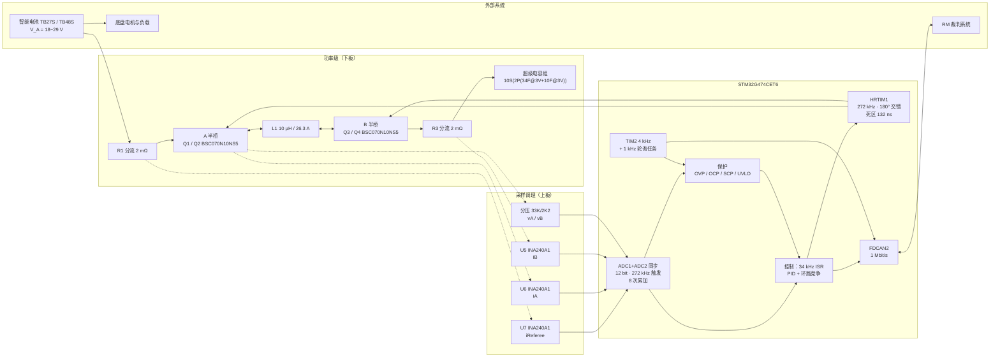
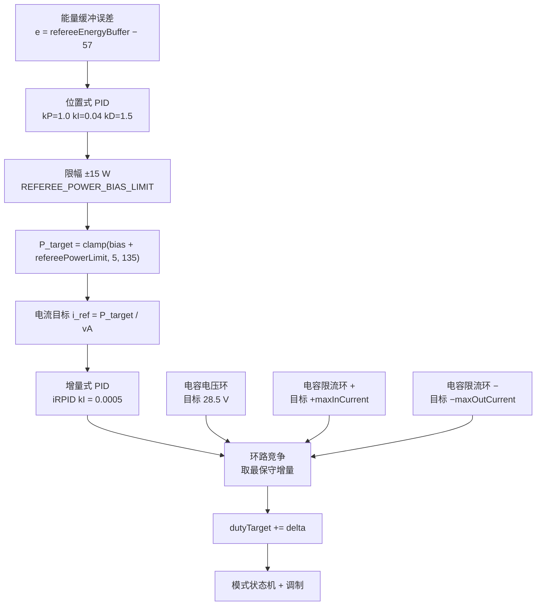
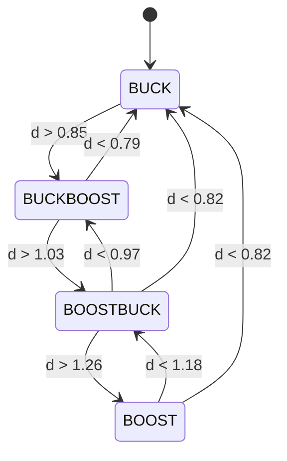
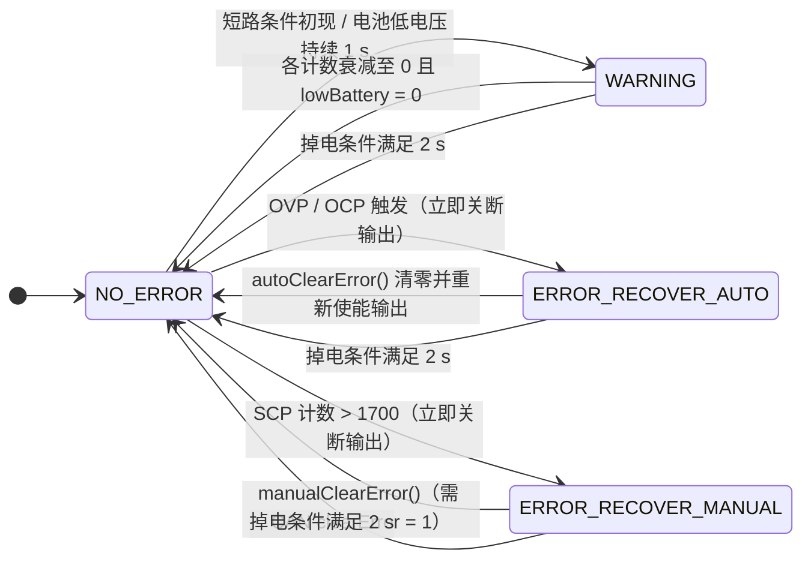
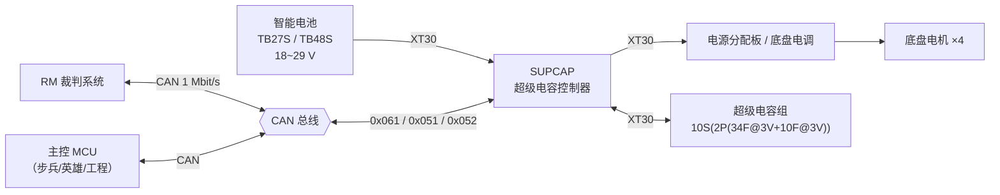
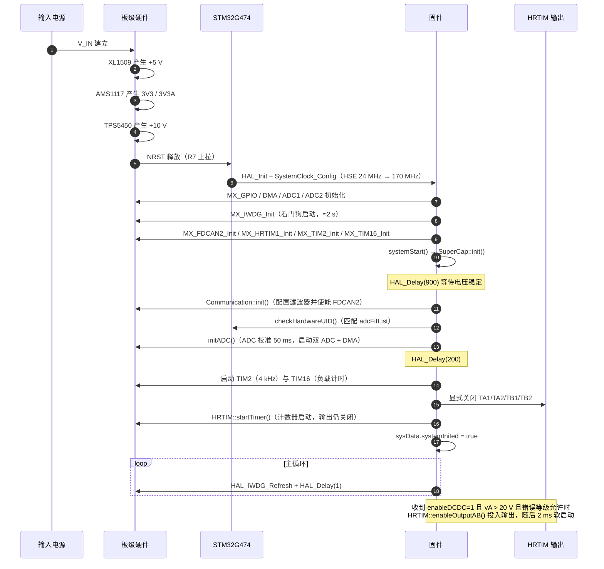

# SUPCAP 超级电容控制器 技术参考手册

**Technical Reference Manual — SUPCAP Supercapacitor Controller**

---

## 0. 文档信息

| 项目 | 内容 |
|---|---|
| 文档标题 | SUPCAP 超级电容控制器技术参考手册 |
| 文档编号 | RM2027-AN-001-1 |
| 版本 | V0.1 |
| 日期 | 2026/10/13 |
| 作者 | 谢忠宝 |
| 组织 | 【待补充：战队/组织全称】 |
| 保密等级 | 【待补充：保密等级（公开 / 队内 / 受限）】 |
| 产品名称 | SUPCAP 超级电容控制器（含配套超级电容组） |
| 文档类型 | 技术参考手册 + 数据手册（混合风格） |
| 适用对象 | 2027 赛季 RoboMaster 超级电容控制器硬件与固件 |
| 适用固件 | 本仓库 `master` 分支当前固件（版本号【待补充：固件版本号，仓库中未见版本宏定义】） |
| 目标读者 | RM 嵌入式工程师、电控工程师、硬件工程师、测试工程师、算法工程师 |

> **注释**
> 本文档描述**当前固件实现**与**现有原理图（上板 beta_1 / 下板 beta，均更新至 2026-10-13）**所确定的接口、参数与行为。
> 凡在现有资料中无法确证的数值、协议细节或测试结果，均以 `【待补充：…】` 显式标注，不作推测性填充。
> 本文档为队内技术资料，**不由任何半导体厂商发布，亦不代表任何厂商的官方立场**。

### 修订历史

| 版本 | 日期 | 作者 | 变更说明 |
|---|---|---|---|
| V0.1 | 2026/10/13 | 谢忠宝 | 初稿。基于现有固件（`master`）与上板/下板原理图建立接口、参数、控制策略与通信协议描述；实测类数据待补充 |

---

## 待补充信息清单（首版）

下表汇总当前**无法从固件、原理图或既有资料中确证**的信息。每项均给出建议的获取方式，便于安排测试或补充资料。

| 编号 | 位置（章节） | 缺失内容 | 建议获取方式 |
|---|---|---|---|
| M-01 | 6.2 | ESD 额定值（HBM / CDM）、各接口 ESD 等级 | ESD 测试台实测；或依据器件 datasheet 汇总 |
| M-02 | 6.4 | 热阻 $R_{\theta JA}$、$R_{\theta JC}$、结温上限、温升曲线 | 热成像 + 热电偶实测；功率级 MOSFET 器件 datasheet |
| M-03 | 6.4 / 7.3.4 | 温度采样通道（板上是否有 NTC / 数字温度传感器） | 原理图网表级确认；当前固件中无温度采样代码 |
| M-04 | 6.6 | 上电就绪时间、使能响应时间、故障关断延时、通信响应延时 | 示波器 / 逻辑分析仪实测 |
| M-05 | 6.7 | 效率曲线、输出纹波、瞬态响应、温升、$V_{CAP}$ 调节特性等全部典型特性曲线 | 电子负载 + 功率分析仪实测 |
| M-06 | 6.1 | 依赖器件实测的绝对最大额定值（母线浪涌、瞬态过压能力） | 器件 datasheet + 浪涌实测 |
| M-07 | 7.3.4 | 4 路 2 mΩ 分流 ↔ 4 路 INA240 通道的网表级物理对应确认 | 原理图网表导出核对（当前依据网标推断） |
| M-08 | 6.3 / 7.3.4 | 采样基准网络 `VF` 的产生电路与实际电压值、温漂 | 万用表实测 `VF` 节点；核对该网络产生器件 |
| M-09 | 7.3.8 | 固件版本号、编译时间标识、参数持久化方案（当前固件无 Flash 参数存储、无 IAP） | 固件侧补齐版本宏；如需在线升级需另行设计 |
| M-10 | 0 | 战队/组织全称、保密等级、联系人 | 队内管理信息补充 |
| M-11 | 3 / 6.5 | 超级电容组串并联拓扑的准确解读（等效容量 4.4 F 或 8.8 F，见 7.3.2） | 电容组实物清点 + 实测充放电标定 |
| M-12 | 6.3 | 工作环境温度范围、存储温度范围、湿度与散热条件 | 队内环境要求确认 |
| M-13 | 6.1 | 反接保护的实际实现方式（固件中无检测逻辑） | 硬件侧确认防反接器件与保护策略 |
| M-14 | 6.5 | 无线充电（WPT）相关电气规格（硬件是否存在、目标电压 26.2 V 之外的参数） | 硬件方案确认；当前固件 `WPT_HARDWARE` 未定义 |
| M-15 | 8.5 | 完整测试用例、测试记录与合格判据 | 依据 8.5 节建议清单执行并归档 |

### 来源差异清单（不进入正文规格表）

依据"以固件为准"的处理原则，下列差异不作为规格值写入正文，仅在此列出以供复核：

| 编号 | 项目 | 固件（权威） | 原理图 / 既有资料 | 处理 |
|---|---|---|---|---|
| D-01 | MCU 型号 | `STM32G474CET6`（LQFP48，见 `supcap.ioc:141`、`supcap.ioc:156`） | 上板原理图同时存在 `STM32G474CEU6`（U4，QFN48）与 `STM32G474CBT6`（U11，LQFP48）两个符号 | 文档以 `STM32G474CET6` 为准；上板为兼容两封装的同封装位设计 |
| D-02 | HSE 晶振频率 | 24 MHz（`Core/Inc/stm32g4xx_hal_conf.h:118`） | 上板原理图 X1 标注 **25 MHz**（C16/C17 = 12 pF，R6 = 1 MΩ） | 文档时钟、开关频率、CAN 速率均按 24 MHz 推导；实际晶振需与固件一致，否则所有频率按 25/24 比例偏移 |
| D-03 | 电流 / 功率能力 | 限流 15 A（`Config.hpp:31`）、`OCP_CAPARR` 25.5 A（`Config.hpp:61`）、`MAX_INDUCTOR_CURRENT` 23 A（`Config.hpp:16`） | 既有产品说明草稿标称"输出电流高达 21 A、功率最高 520 W" | 21 A / 520 W 视为**设计目标**，不写入固件约束表 |
| D-04 | 参考文档 | — | `Hardware/` 目录下 3 份 TI 应用文档 PDF 在 git 中已删除，工作区不可读 | 不引用、不转述其内容 |
| D-05 | 上板 MCU 供电 | 固件按 3.3 V 域工作 | 上板同时存在 `+5 V`（XL1509-5.0）与 `3V3` / `3V3A`（AMS1117-3.3 V）两路 | 以 3V3 为数字域、3V3A 为模拟域供电，见 7.3.4 |

---

## 1. 特性

### 1.1 功率拓扑

- **单电感四开关升降压（FSBB, Four-Switch Buck-Boost）拓扑**，两个半桥与一个功率电感构成；支持电池母线（$V_A$）与超级电容组（$V_B$）之间的双向能量流动（`Hardware/SCH_超电下板-beta_2026-10-13.pdf`）。
- 功率级器件：4 × `BSC070N10NS5`（100 V OptiMOS MOSFET，Q1–Q4），半桥驱动 2 × `LM5109BMAX`（U2/U3），功率电感 `L1 = 10 µH / 26.3 A / 9 mΩ`（下板原理图）。
- 两路半桥由 HRTIM1 的 TIMER_A / TIMER_B 驱动，**180° 交错**（`Core/Src/hrtim.c:136`、`Core/Src/hrtim.c:143`）。
- 硬件死区插入：预分频 `MUL8`，Rising / Falling = 90 计数值，**实测等效死区约 132 ns（由配置推导）**（`Core/Src/hrtim.c:158-171`）。

### 1.2 控制

- 主控 MCU：**STM32G474CET6**（Cortex-M4F @ 170 MHz，LQFP48，512 KB Flash / 128 KB SRAM）（`supcap.ioc:141`、`supcap.ioc:156`、`STM32G474XX_FLASH.ld`）。
- 使用 **HRTIM1 高分辨率定时器**（5.44 GHz 等效计数时钟，由 170 MHz × 32 倍频得到）产生 PWM：
  - 开关频率 $f_{SW} = 272\ \text{kHz}$（由 `Period = 20000` 与 MUL32 推导，`Core/Src/hrtim.c:73-75`）；
  - 控制中断频率 **34 kHz**（Master `RepetitionCounter = 7`，即每 8 个开关周期触发一次 MREP 中断，`Core/Src/hrtim.c:74`、`Core/cppSrc/PowerManager.cpp:142`）。
- **四模式调制状态机**（BUCK / BUCKBOOST / BOOSTBUCK / BOOST）带迟滞切换，见 7.3.1 与 7.3.7。
- 双 ADC 规则组**同步采样**（ADC1 主 + ADC2 从，`ADC_DUALMODE_REGSIMULT`），12 位分辨率，由 HRTIM 触发（`Core/Src/adc.c:59-71`）。
- 每 34 kHz 控制周期累加 8 次采样后换算，等效**单通道 1.36 kHz 输出速率（由配置推导）**，并对电流量施加一阶 IIR 滤波（$\alpha = 0.7$，`Core/cppInc/Config.hpp:9-10`）。
- **按 MCU 96 位唯一 ID 逐板标定**：采样换算式 $x = K \cdot \sum_{8} \text{raw} + B$，标定系数表见 `Core/cppSrc/Protection.cpp:9-14`，标定流程见 8.5。
- 两级控制结构：**裁判系统功率外环（位置式 PID）** + **4 路增量式 PID 内环**（裁判电流环、电容电压环、电容限流环 ±），环路竞争仲裁见 7.3.3。

### 1.3 通信

- **FDCAN2 经典 CAN（Classic CAN）**，波特率 1 Mbit/s，采样点 80 %（由 `NominalPrescaler = 17 / TSeg1 = 7 / TSeg2 = 2 / SJW = 1` 与 170 MHz FDCAN 时钟推导，`Core/Src/fdcan.c:47-50`）。
- 接收帧 ID `0x061`（裁判系统下发的功率限制与使能控制），发送帧 ID `0x051`（兼容格式）与 `0x052`（新格式，由接收帧配置位切换）（`Core/cppInc/Config.hpp:39-41`）。
- 物理层：`TJA1050T/CM,118`（U8）收发器，`NUP2105L`（D2）总线 ESD 保护，120 Ω 终端（R23），两个并联的 `WAFER-GH1.25-2PLB` 接口连接器（CN1 / CN2）位于**同一 CAN 总线**（上板原理图）。
- 通信报文格式与位定义见 7.4。

### 1.4 保护与安全

- 过压保护（OVP）、过流保护（OCP）、短路保护（SCP）、输入欠压锁定（UVLO）、电池低电压告警。
- 四级错误等级 + 16 位错误码位图，支持**自动恢复**、**手动恢复（CAN 命令）**与**掉电自动清零**，见 7.3.5 与 7.3.7。
- 独立看门狗 **IWDG ≈ 2 s**（`IWDG_PRESCALER_64`、`Reload = 1000`、LSI ≈ 32 kHz，`Core/Src/iwdg.c:41-43`），主循环每 1 ms 喂狗（`Core/cppSrc/SuperCap.cpp:24-25`）。
- **超温保护与反接检测在当前固件中不存在**（详见 7.3.5 与 M-03 / M-13）。

### 1.5 机械与接口

- 板对板（BTB）0.8 mm 双板结构：上板（控制板）+ 下板（功率板）。
- 功率接口：`XT30UPB-M` × 3（CN1 / CN3 / CN4）、`XT30UPB-F30.G.Y` × 1（CN2）（下板原理图）。
- 控制接口：CAN × 2（`WAFER-GH1.25-2PLB`）、SWD 调试口 × 1（`WAFER-GH1.25-4PWB`，1 = SWCLK、2 = SWDIO、3 = GND、4 = 3V3）（上板原理图）。
- 上板 LED1（`XL-1608UGC-04` + R18 8.2 kΩ）为**硬连线 3V3 电源指示**，不受 MCU 控制（`Core/Src/gpio.c` 中 `MX_GPIO_Init` 未配置任何 GPIO）。

---

## 2. 应用

- RoboMaster 步兵 / 英雄 / 工程机器人底盘**功率缓冲与母线功率钳位**，满足裁判系统对底盘瞬时功率的限制要求。
- 与 DJI 智能电池 **TB27S / TB48S** 的 $V_{IN}$ 电压范围（18 V ~ 29 V）配合使用。
- 作为**旁路型（bypass）超级电容控制器**：电池与电容组之间通过 FSBB 双向变换器交换能量，实现充电储能与瞬时功率补充。
- 与 RM 裁判系统通过 CAN 总线交互，接收功率上限与缓冲能量目标，回传状态与功率信息。
- 适用于需要抑制电池母线瞬时电流冲击、提升加速瞬时爆发功率的场合。

---

## 3. 说明

### 3.1 总体说明

SUPCAP 超级电容控制器是基于 **STM32G474CET6** 的旁路超级电容控制器，采用**单电感四开关升降压（FSBB）** 拓扑，在电池母线（$V_A$，18–29 V 范围）与超级电容组（$V_B$）之间实现双向 DC/DC 变换。

控制器以 34 kHz 频率执行闭环控制，具备以下功能：

1. **电容组充电管理**：将 $V_B$ 充电至目标上限 28.5 V（`CAPARR_MAX_VOLTAGE`，`Core/cppInc/Config.hpp:27`），并按电容组电压动态限制充电电流（见 7.3.1）。
2. **放电与能量缓冲**：电容组电压高于母线时向母线回馈能量，实现功率钳位；缓冲能量目标 57 J（`REFEREE_ENERGY_BUFFER`，`Core/cppInc/Config.hpp:19`）。
3. **RM 裁判系统功率限制与能量调度**：接收裁判系统下发的功率上限与能量缓冲值，通过位置式 PID 生成目标功率偏置，见 7.3.3。
4. **电压、电流采样**：双 ADC 同步采样 4 路电流 + 3 路电压，逐板标定，见 7.3.4。
5. **保护机制**：过压、过流、短路、输入欠压，见 7.3.5。
6. **CAN 通信**：与裁判系统交互，见 7.3.6 与 7.4。

> **注意**
> 数字控制、采样、保护与通信全部在单一 STM32 微控制器上实现。当前固件**不包含** Flash 参数存储、IAP 固件升级、UART/USB 通道（见 7.3.8）。

### 3.2 上电与时钟

系统时钟由 HSE（24 MHz）经 PLL（M = 6，N = 85，R = 2）倍频至 170 MHz，AHB / APB1 / APB2 均为 1 分频，Flash 等待周期 4，稳压器工作于 `VOLTAGE_SCALE1_BOOST`（`Core/Src/main.c:129-158`、`Core/Inc/stm32g4xx_hal_conf.h:118`）。

$$
f_{SYSCLK} = \frac{24\ \text{MHz}}{6} \times 85 \times \frac{1}{2} = 170\ \text{MHz}
$$

---

## 4. 器件/模块比较

### 4.1 与纯升压（Boost-only）方案的比较

| 比较项 | 本设计（单电感 FSBB，四开关） | 纯 Boost 升压方案（两开关） |
|---|---|---|
| 输入电压可利用范围 | $V_A$ 在 18–29 V 全范围可用；$V_B$ 可低于、等于或高于 $V_A$ | 仅当 $V_B > V_A$ 时正常工作；$V_B$ 低于 $V_A$ 时无法充电 |
| 电容组可放电深度 | 可放至 `CAPARR_CUTOFF_VOLTAGE` = 5.0 V（`Config.hpp:25`）以下仍可升压回馈母线 | 受 $V_B > V_A$ 约束，放电深度受限，可利用能量比例显著降低 |
| 器件数量 | 4 × MOSFET + 2 × 半桥驱动 + 单电感 | 2 × MOSFET + 1 × 驱动 + 单电感 |
| 控制复杂度 | 4 种调制模式 + 迟滞状态机 | 单一升压调制 |
| 能量利用率 | 电容储能按 $E = \tfrac{1}{2}CV^2$ 计，可放至更低电压，等效可用能量更高 | 低压段能量无法取出 |

### 4.2 与其他降压-升压拓扑的比较

| 比较项 | 单电感 FSBB（本设计） | 双电感四开关（2× 半桥 + 2 电感） | 单电感 Buck-Boost（两开关，反极性输出） |
|---|---|---|---|
| 输出极性 | 与输入同极性 | 与输入同极性 | 反极性 |
| 主管利用率 | 4 管全部参与驱动 | 4 管全部参与驱动 | 2 管 |
| 电感应力 | 单电感承受全电流 | 电流分流，电感体积可减小 | 单电感承受全电流 |
| 适用性 | 适合宽输入/输出双向场合 | 适合大功率、低纹波场合 | 一般用于低压恒功率场合 |

### 4.3 模块构成

| 模块 | 载体 | 主要器件 | 功能 |
|---|---|---|---|
| 控制板（上板） | `SCH_超电上板-beta_1_2026-10-13.pdf` | U11 `STM32G474CBT6`（LQFP48）/ U4 `STM32G474CEU6`（QFN48，同封装位兼容）、4 × `INA240A1PWR`、`TJA1050T/CM,118`、`XL1509-5.0`、2 × `AMS1117-3.3V` | 数字控制、采样调理、电源管理、CAN 收发、SWD 调试 |
| 功率板（下板） | `SCH_超电下板-beta_2026-10-13.pdf` | 4 × `BSC070N10NS5`、2 × `LM5109BMAX`、`L1 = 10 µH / 26.3 A`、4 × 2 mΩ 分流、`TPS5450DDAR`（辅助 10 V 电源） | FSBB 功率级、栅极驱动、电流检测、TVS / 保险丝保护、XT30 功率连接器 |
| 超级电容组 | 配套组件 | 10S(2P(34 F@3 V + 10 F@3 V)) | 能量缓冲 |

> **注释**
> 上板 MCU 封装位同时提供 QFN48（U4）与 LQFP48（U11）两种符号，实际装配以工程配置的 `STM32G474CET6`（LQFP48）为准。见来源差异清单 D-01。

---

## 5. 引脚/接口配置与功能

### 5.1 MCU 引脚配置（STM32G474CET6，LQFP48）

引脚编号对应 LQFP48 封装（与上板原理图 U11 符号引脚编号一致）。引脚分配依据固件外设初始化代码（`Core/Src/gpio.c`、`Core/Src/adc.c:232-306`、`Core/Src/fdcan.c:96-101`、`Core/Src/hrtim.c:263-268`）与上板原理图网络标注共同确定。

| 引脚号 | 名称 | 类型 | 方向 | 功能 | 复位状态 | 备注 |
|---|---|---|---|---|---|---|
| 1 | VBAT | 电源 | — | 备份电源域 | — | 与 3V3 同网络（据上板原理图） |
| 2 | PC13 | GPIO | — | 未使用 | 模拟输入 | 原理图未标注网络 |
| 3 | PC14-OSC32_IN | 复用 | — | 未使用（LSE 未启用） | 复用功能（OSC32_IN） | 固件未配置 LSE |
| 4 | PC15-OSC32_OUT | 复用 | — | 未使用（LSE 未启用） | 复用功能（OSC32_OUT） | 固件未配置 LSE |
| 5 | PF0-OSC_IN | 复用 | 输入 | HSE 主晶振输入 | 复用功能（OSC_IN） | 接 X1（原理图标称 25 MHz，固件按 24 MHz 配置，见 D-02） |
| 6 | PF1-OSC_OUT | 复用 | 输出 | HSE 主晶振输出 | 复用功能（OSC_OUT） | 接 X1；C16/C17 = 12 pF，R6 = 1 MΩ |
| 7 | PG10-NRST | 复位 | 输入 | 系统复位 | 复位输入（内部上拉） | R7 = 10 kΩ 外部上拉到 3V3，C11 = 100 nF 到 GND |
| 8 | PA0 | GPIO | — | 未使用 | 模拟输入 | 原理图未标注网络 |
| 9 | PA1 | GPIO | — | 未使用 | 模拟输入 | 原理图未标注网络 |
| 10 | PA2 | 模拟 | 输入 | ADC1_IN3 — `iW`（电容组/无线充侧电流） | 模拟输入 | 经 U10（INA240A1）放大；本构建 `WPT_HARDWARE` 未定义，采样后不参与运算 |
| 11 | PA3 | 模拟 | 输入 | ADC1_IN4 — `iB`（B 桥臂/电容组侧电流） | 模拟输入 | 经 U5（INA240A1），采样电阻 R3 = 2 mΩ |
| 12 | PA4 | GPIO | — | 未使用 | 模拟输入 | 原理图未标注网络 |
| 13 | PA5 | 模拟 | 输入 | ADC2_IN13 — `iA`（A 桥臂/母线侧电流） | 模拟输入 | 经 U6（INA240A1），采样电阻 R2 = 2 mΩ |
| 14 | PA6 | 模拟 | 输入 | ADC2_IN3 — `iReferee`（电池/裁判端电流） | 模拟输入 | 经 U7（INA240A1），采样电阻 R1 = 2 mΩ |
| 15 | PA7 | GPIO | — | 未使用 | 模拟输入 | 原理图未标注网络 |
| 16 | PB0 | GPIO | — | 未使用 | 模拟输入 | 原理图未标注网络 |
| 17 | PB1 | GPIO | — | 未使用 | 模拟输入 | 原理图未标注网络 |
| 18 | PB2 | GPIO | — | 未使用 | 模拟输入 | 原理图未标注网络 |
| 19 | VSSA | 电源 | — | 模拟地 | — | 接 AGND |
| 20 | VREF+ | 电源 | — | ADC 基准输入 | — | 接网络 `VF`（与 4 路 INA240 的 REF1/REF2 同网络）；实际电压值【待补充，见 M-08】 |
| 21 | VDDA | 电源 | — | 模拟电源 | — | 接 3V3A（AMS1117-3.3 V，Q1/Q2） |
| 22 | PB10 | GPIO | — | 未使用 | 模拟输入 | 原理图未标注网络 |
| 23 | VSS | 电源 | — | 数字地 | — | 接 GND |
| 24 | VDD | 电源 | — | 数字电源 | — | 接 3V3 |
| 25 | PB11 | 模拟 | 输入 | ADC1_IN14 — `vA`（电池/母线电压） | 模拟输入 | 电阻分压 33 kΩ / 2.2 kΩ + 3 nF（R12/R13、C23） |
| 26 | PB12 | 模拟 | 输入 | ADC1_IN11 — `vB`（电容组电压） | 模拟输入 | 电阻分压 33 kΩ / 2.2 kΩ + 3 nF（R14/R15、C24） |
| 27 | PB13 | GPIO | — | 未使用 | 模拟输入 | 原理图未标注网络 |
| 28 | PB14 | GPIO | — | 未使用 | 模拟输入 | 原理图未标注网络 |
| 29 | PB15 | 模拟 | 输入 | ADC2_IN15 — `vW`（无线充电压） | 模拟输入 | 电阻分压 33 kΩ / 2.2 kΩ + 3 nF（R16/R17、C25）；本构建未启用 |
| 30 | PA8 | 复用 | 输出 | HRTIM1_CHA1 — A 桥臂高侧驱动 | 复用功能（HRTIM1） | 经 BTB 连接至下板 AHI → U2（LM5109B） |
| 31 | PA9 | 复用 | 输出 | HRTIM1_CHA2 — A 桥臂低侧驱动 | 复用功能（HRTIM1） | 经 BTB 连接至下板 ALI → U2 |
| 32 | PA10 | 复用 | 输出 | HRTIM1_CHB1 — B 桥臂高侧驱动 | 复用功能（HRTIM1） | 经 BTB 连接至下板 BHI → U3 |
| 33 | PA11 | 复用 | 输出 | HRTIM1_CHB2 — B 桥臂低侧驱动 | 复用功能（HRTIM1） | 经 BTB 连接至下板 BLI → U3 |
| 34 | PA12 | GPIO | — | 未使用 | 模拟输入 | 原理图未标注网络 |
| 35 | VSS | 电源 | — | 数字地 | — | 接 GND |
| 36 | VDD | 电源 | — | 数字电源 | — | 接 3V3 |
| 37 | PA13 | 复用 | 双向 | SYS_JTMS-SWDIO — SWD 数据线 | 复用功能（SWD） | 接 U9 调试口第 2 脚（WAFER-GH1.25-4PWB） |
| 38 | PA14 | 复用 | 输入 | SYS_JTCK-SWCLK — SWD 时钟线 | 复用功能（SWD） | 接 U9 调试口第 1 脚 |
| 39 | PA15 | 复用 | — | 未使用（JTAG 默认功能） | 复用功能（JTAG JTDI） | 固件未重映射 |
| 40 | PB3 | 复用 | — | 未使用（JTAG 默认功能） | 复用功能（JTAG JTDO/TRACESWO） | 固件未重映射 |
| 41 | PB4 | 复用 | — | 未使用（JTAG 默认功能） | 复用功能（JTAG NJTRST） | 固件未重映射 |
| 42 | PB5 | 复用 | 输入 | FDCAN2_RX | 模拟输入 | 复用功能 AF9_FDCAN2，无上下拉，低速驱动（`Core/Src/fdcan.c:96-101`） |
| 43 | PB6 | 复用 | 输出 | FDCAN2_TX | 模拟输入 | 复用功能 AF9_FDCAN2；接 U8（TJA1050T）TXD |
| 44 | PB7 | GPIO | — | 未使用 | 模拟输入 | 原理图未标注网络 |
| 45 | PB8-BOOT0 | 输入 | 输入 | BOOT0 — 启动模式选择 | 输入（BOOT0） | R1 = 10 kΩ 外部下拉至 GND（自 Flash 启动） |
| 46 | PB9 | GPIO | — | 未使用 | 模拟输入 | 原理图未标注网络 |
| 47 | VSS | 电源 | — | 数字地 | — | 接 GND |
| 48 | VDD | 电源 | — | 数字电源 | — | 接 3V3 |

> **注释**
> "复位状态"列给出复位后引脚的默认功能，依据 STM32G474 参考手册的 GPIO 端口复位值；本文档不逐位复述寄存器复位值。
> 固件 `MX_GPIO_Init()` 仅使能 GPIOF / GPIOA / GPIOB 时钟，未配置任何 GPIO 的输入输出模式（`Core/Src/gpio.c:47-52`），所有引脚均由外设初始化函数（ADC / HRTIM / FDCAN MspInit）按各自功能配置。

> **注意**
> 引脚 10（PA2）与引脚 29（PB15）虽然被 ADC 采样，但在当前构建中 `WPT_HARDWARE` **未定义**（全仓库检索无 `#define WPT_HARDWARE`），对应的 `iWPT`、`vWPT`、`pWPT` 恒为 0，`iCap` 仅取 `iB`（`Core/cppSrc/SampleManager.cpp:77-81`）。若后续启用无线充电硬件，需在编译期定义该宏。

### 5.2 上板接口连接器

| 位号 | 器件型号 | 引脚数 | 连接内容 | 备注 |
|---|---|---|---|---|
| U1 | HEADER 2×10 PLUG | 20 | 与下板的板对板连接（含 AHI/ALI/BHI/BLI 栅极驱动信号、采样信号、辅助电源） | 0.8 mm 板对板 |
| U4 | BTB SOCKET 0.8 mm | 20 + EP | 下板对应插座（下板位号 U4） | 与下板 U4 对插 |
| CN1 | WAFER-GH1.25-2PLB | 2 | CAN 总线接口 1 | 与 CN2 处于同一总线 |
| CN2 | WAFER-GH1.25-2PLB | 2 | CAN 总线接口 2 | 与 CN1 处于同一总线 |
| U9 | WAFER-GH1.25-4PWB | 4 | SWD 调试口：1 = SWCLK，2 = SWDIO，3 = GND，4 = 3V3 | 用于烧录与调试 |

### 5.3 下板功率连接器

| 位号 | 器件型号 | 连接内容 | 备注 |
|---|---|---|---|
| CN1 | XT30UPB-M | 电池/裁判系统母线（$V_A$ 侧） | — |
| CN3 | XT30UPB-M | 底盘/负载输出 | — |
| CN4 | XT30UPB-M | 超级电容组（$V_B$ 侧） | — |
| CN2 | XT30UPB-F30.G.Y | 辅助 / 备用功率接口 | 具体定义【待补充：下板 CN2 的电气定义】 |

### 5.4 采样链映射

电流采样链路（采样电阻 → 电流放大器 → MCU 引脚 → 固件变量）：

| 采样电阻 | 采样节点 | 放大器 | 输出引脚 | 固件变量 | 说明 |
|---|---|---|---|---|---|
| R1（2 mΩ） | VCHAS / VREF（输入侧） | U7（INA240A1PWR，增益 20 V/V） | PA6 / ADC2_IN3 | `iReferee` | 电池/裁判端电流 |
| R2（2 mΩ） | APWR / APWR_CS（A 桥臂侧） | U6（INA240A1PWR） | PA5 / ADC2_IN13 | `iA` | A 桥臂母线侧电流 |
| R3（2 mΩ） | BPWR / BPWR_CS（B 桥臂侧） | U5（INA240A1PWR） | PA3 / ADC1_IN4 | `iB` | B 桥臂电容组侧电流 |
| R4（2 mΩ） | VCAP / VWLS（电容组侧） | U10（INA240A1PWR） | PA2 / ADC1_IN3 | `iW` | 未启用（`WPT_HARDWARE` 未定义） |

电压采样链路：

| 分压网络 | 分压比（标称） | 输出引脚 | 固件变量 |
|---|---|---|---|
| R12 / R13（33 kΩ / 2.2 kΩ）+ C23 | ≈ 1/16（由标称阻值推导） | PB11 / ADC1_IN14 | `vA` |
| R14 / R15（33 kΩ / 2.2 kΩ）+ C24 | ≈ 1/16（由标称阻值推导） | PB12 / ADC1_IN11 | `vB` |
| R16 / R17（33 kΩ / 2.2 kΩ）+ C25 | ≈ 1/16（由标称阻值推导） | PB15 / ADC2_IN15 | `vW`（未启用） |

> **注意**
> 表 5.4-1 与表 5.4-2 中的物理对应关系依据上板原理图网络标注（`APWR_CS` / `BPWR_CS` / `VCHAS` / `VWLS` / `VF` 节点）与固件 ADC 通道配置交叉确定。网表级逐器件复核见 M-07。

> **注释**
> 4 路 INA240 的 REF1 / REF2 引脚均接至网络 `VF`，与 MCU 的 `VREF+`（引脚 20）为同一网络。该网络的产生电路与实际电压值当前无法从原理图文本提取中确定，见 M-08。INA240 的输出经 2.2 kΩ + 100 nF 一阶 RC 后进入 ADC（上板 R3/R4/R5 与 C27/C28/C26/C4）。

---

## 6. 规格

> **注释**
> 本章参数分为三类，并在"测试条件"列中标注：
> ① **固件常量**：直接取自固件源码，为权威值，标注文件与行号；
> ② **由配置推导**：由器件参数与固件配置计算得到，非实测值；
> ③ **【待补充】**：现有资料无法确证，需实测或补充资料。
> 除另有说明外，环境条件为 $T_A = 25\ \text{°C}$。

### 6.1 绝对最大额定值

| 参数 | 测试条件 | 最小值 | 典型值 | 最大值 | 单位 |
|---|---|---|---|---|---|
| 母线输入电压 $V_A$（持续） | 由 TVS `SMBJ30CA`（D1/D4）关断电压决定 | — | — | 30 | V |
| 电容组电压 $V_B$（持续） | 由 TVS `SMF28A`（D15–D18）与固件 `OVP_B` 共同约束 | — | — | 30.5 | V |
| 母线功率接口过流 | 由保险丝 `BSMD2410C-2300T`（F1/F2）额定值决定 | — | — | 30 | A |
| MOSFET 漏源电压 $V_{DS}$ | Q1–Q4 = `BSC070N10NS5` | — | — | 100 | V |
| 功率电感电流 $i_L$（持续） | L1 = 10 µH，额定 26.3 A | — | — | 26.3 | A |
| 电感电流（固件限制） | `MAX_INDUCTOR_CURRENT`，`Core/cppInc/Config.hpp:16` | — | 23.0 | — | A |
| 栅极驱动器供电 | U2/U3 = `LM5109BMAX`，具体电源轨电压【待补充：栅极驱动辅助电源电压与上电时序】 | — | — | — | V |
| 焊接温度 | 回流焊，具体工艺【待补充：焊接工艺曲线】 | — | — | — | °C |
| 存储温度 | 【待补充：存储温度范围】 | — | — | — | °C |
| 结温（MOSFET / MCU） | 【待补充：功率级与 MCU 的 $T_J$ 上限】 | — | — | — | °C |

> **警告**
> 超出上表"最大值"的应力可能造成器件永久损坏。上述数值为**应力额定值**，不代表在这些条件下器件可正常工作；可正常工作的条件见 6.3。
> 母线反接防护的实现方式在当前固件中**无检测逻辑**（见 7.3.5）；反接时是否损坏取决于硬件，见 M-13。

### 6.2 ESD 额定值

| 参数 | 测试条件 | 最小值 | 典型值 | 最大值 | 单位 |
|---|---|---|---|---|---|
| 人体模型（HBM） | 全部对外接口与连接器 | 【待补充：HBM 实测等级（M-01）】 | — | — | kV |
| 充电器件模型（CDM） | 全部对外接口与连接器 | 【待补充：CDM 实测等级（M-01）】 | — | — | kV |
| CAN 总线接触放电 | IEC 61000-4-2，CN1 / CN2 | 【待补充：实际测试等级与结果（M-01）】 | — | — | kV |
| 功率接口接触放电 | IEC 61000-4-2，CN1 / CN3 / CN4 | 【待补充：实际测试等级与结果（M-01）】 | — | — | kV |

> **注释**
> 硬件上已配置的 ESD / 浪涌抑制器件：CAN 总线 `NUP2105L`（D2）；母线 `SMBJ30CA`（D1/D4，双向 TVS）；电容组 / 功率节点 `SMF28A`（D15–D18）。
> 上述器件的**保护能力**可在其各自手册中查得，但**整机 ESD 等级**必须实测，本手册不代之以器件等级。

### 6.3 推荐工作条件

| 参数 | 测试条件 | 最小值 | 典型值 | 最大值 | 单位 |
|---|---|---|---|---|---|
| 母线输入电压 $V_A$ | 输出使能、持续工作 | 18 | — | 29 | V |
| 输入欠压锁定（UVLO）阈值 | `REFEREE_UVLO_LIMIT`，`Config.hpp:44` | — | 18.0 | — | V |
| UVLO 恢复阈值 | `REFEREE_UVLO_RECOVERY`，`Config.hpp:45` | — | 20.0 | — | V |
| 电容组电压 $V_B$ | 持续工作范围 | 0 | — | 28.5 | V |
| 电容组充电目标电压 | `CAPARR_MAX_VOLTAGE`，`Config.hpp:27` | — | 28.5 | — | V |
| 电容组过压保护阈值 | `OVP_B`，`Config.hpp:58` | — | 30.5 | — | V |
| 电容组最大充/放电电流 | $V_{CAP} > 10\ \text{V}$（`CAPARR_LOW_VOLTAGE`），恒定 | — | 15.0 | — | A |
| 电容组最大电流（低压区） | $5\ \text{V} < V_{CAP} \le 10\ \text{V}$，随 $V_{CAP}$ 线性降额（区间内最小值 1.0 A，$V_{CAP} \to 10\ \text{V}$ 时趋近 15.0 A） | 1.0 | — | 15.0 | A |
| 电容组最大电流（截止区） | $V_{CAP} \le 5\ \text{V}$，$0.2 + 0.16\,V_{CAP}$ | 0.2 | — | 1.0 | A |
| 开关频率 $f_{SW}$ | 由 `Period = 20000` + MUL32 + 170 MHz 推导 | — | 272 | — | kHz |
| 控制中断频率 | Master `RepetitionCounter = 7`（8 分频） | — | 34 | — | kHz |
| ADC 触发频率 | HRTIM 触发 1，`ADCPostScaler = 0` | — | 272 | — | kHz |
| ADC 单通道数据更新率 | 每 8 次触发累加后换算 | — | 34 | — | kHz |
| 数字电源电压 | 3V3（`AMS1117-3.3V`） | 【待补充：3V3 容差与负载能力】 | 3.3 | — | V |
| 模拟电源电压 | 3V3A（`AMS1117-3.3V`） | 【待补充：3V3A 容差与纹波】 | 3.3 | — | V |
| ADC 基准电压 $V_{REF+}$（网络 `VF`） | 由标定系数反推，见 6.5.2 | ≈ 2.8 | ≈ 2.9 | ≈ 3.0 | V |
| 工作环境温度 $T_A$ | 强制风冷 / 自然对流【待补充（M-12）】 | — | — | — | °C |

> **注意**
> 6.3 中的"电容组最大电流"三档为固件动态限流曲线（`Core/cppSrc/CapArray.cpp:8-25`），非器件极限。器件极限见 6.1。

### 6.4 热性能信息

| 参数 | 测试条件 | 最小值 | 典型值 | 最大值 | 单位 |
|---|---|---|---|---|---|
| 结至环境热阻 $R_{\theta JA}$（MOSFET Q1–Q4） | 【待补充：实测或器件手册值（M-02）】 | — | — | — | °C/W |
| 结至外壳热阻 $R_{\theta JC}$（MOSFET Q1–Q4） | 【待补充（M-02）】 | — | — | — | °C/W |
| 电感 L1 温升 | 额定电流 26.3 A 连续 | 【待补充（M-02）】 | — | — | °C |
| 采样电阻 R1–R4 温升 | 各 15 A 连续 | 【待补充（M-02）】 | — | — | °C |
| 整板满功率温升 | 520 W 设计目标（见 D-03）下连续运行 | 【待补充（M-02）】 | — | — | °C |
| 板载温度传感器 | — | **无**（固件中不存在温度采样通道与过温保护逻辑，见 7.3.5） | — | — | — |

> **警告**
> 当前设计**不具备温度监测能力**：固件中没有任何 ADC 通道用于温度采样，也没有过温降额或过温关断逻辑（已通过全仓库检索确认）。因此**不得依赖本控制器自身的温度保护**。
> 过温风险只能通过外部手段管理：① 在整机层面限制连续功率；② 由上层控制器依据自身传感器决定是否下发 `enableDCDC = 0`。
> 建议补充的测试：在 25 °C 环境下以额定电流连续运行 30 min，用热像仪记录 Q1–Q4、L1、R1–R4 的表面温度，并按器件手册换算结温，据此确定连续工作功率上限（M-02）。

### 6.5 电气特性

#### 6.5.1 控制与保护门限

以下数值均为**固件常量**（权威值）。由于这些门限在 34 kHz 控制中断或 1 kHz 低频任务中判定，实际的触发时刻存在最多 1 个控制周期（≈ 29.4 µs）或 1 个低频周期（1 ms）的量化延迟。

| 参数 | 测试条件 | 最小值 | 典型值 | 最大值 | 单位 |
|---|---|---|---|---|---|
| A 侧（母线）过压保护 $OVP_A$ | `Config.hpp:57`，`vA > OVP_A` 立即关断输出 | — | 29.0 | — | V |
| B 侧（电容组）过压保护 $OVP_B$ | `Config.hpp:58`，`vB > OVP_B` 立即关断输出 | — | 30.5 | — | V |
| 电容组侧过流保护 | 判定 `iA > OCP_CAPARR`，`Config.hpp:61` | — | 25.5 | — | A |
| 电容组侧过流保护（B 侧） | 判定 `iB > OCP_CAPARR`，`Config.hpp:61` | — | 25.5 | — | A |
| 裁判端过流保护 | 判定 `iReferee > OCP_REFEREE`，`Config.hpp:63` | — | 6.5 | — | A |
| 底盘端过流保护（常量，当前固件未引用） | `OCP_CHASSIS`，`Config.hpp:62` | — | 20.0 | — | A |
| 短路判定电压 | `SCP_VOLTAGE`，`Config.hpp:52` | — | 5.0 | — | V |
| 短路判定电流 | `SCP_CURRENT`，`Config.hpp:53` | — | 5.0 | — | A |
| 短路保护跳闸时间（A 侧） | `vA ≤ 5 V` 且 `−iA ≥ 5 A`，计数 +600/控制周期，阈值 1700 | — | — | ≈ 88 | µs |
| 短路保护跳闸时间（B 侧） | `vB ≤ 5 V` 且 `iB ≥ 5 A`，计数 +300/控制周期，阈值 1700 | — | — | ≈ 176 | µs |
| 短路保护恢复时间常量（未引用） | `SCP_RECOVER_TIME`，`Config.hpp:54` | — | 1000 | — | — |
| 电池低电压告警阈值 | `BATTERY_LOW_LIMIT`，`Config.hpp:48` | — | 20.92 | — | V |
| 电池低电压恢复阈值 | `BATTERY_LOW_RECOVERY`，`Config.hpp:49` | — | 21.6 | — | V |
| 低电压告警确认时间 | 连续 1000 次低频计数（1 kHz） | — | 1.0 | — | s |
| 掉电自动清错时间 | `powerOffCnt > 2000`（1 kHz 计数），条件 $V_A < 18\ \text{V}$ | — | 2.0 | — | s |
| 电容组断路 / 漏电判定阈值（上限） | `CAPARR_CAPACITY_HT = 10.0 F` | — | 10.0 | — | F |
| 电容组断路 / 漏电判定阈值（下限） | `CAPARR_CAPACITY_LT = 0.2 F` | — | 0.2 | — | F |
| 电容组等效容量默认值 | `CAPARR_DEFUALT_CAPACITY`，`Config.hpp:34` | — | 4.4 | — | F |
| 电容组内阻补偿值 | `CAPARR_DCR`，`Config.hpp:30` | — | 0.07 | — | Ω |
| 电容组截止电压 | `CAPARR_CUTOFF_VOLTAGE`，`Config.hpp:25` | — | 5.0 | — | V |
| 电容组低压区边界 | `CAPARR_LOW_VOLTAGE`，`Config.hpp:26` | — | 10.0 | — | V |

#### 6.5.2 采样特性

| 参数 | 测试条件 | 最小值 | 典型值 | 最大值 | 单位 |
|---|---|---|---|---|---|
| ADC 分辨率 | `ADC_RESOLUTION_12B` | — | 12 | — | bit |
| ADC 采样时间 | `ADC_SAMPLETIME_6CYCLES_5` | — | 6.5 | — | ADC 周期 |
| ADC 时钟 | `ADC_CLOCK_SYNC_PCLK_DIV4`（PCLK = 170 MHz） | — | 42.5 | — | MHz |
| 双 ADC 模式 | `ADC_DUALMODE_REGSIMULT`（规则组同步） | — | — | — | — |
| 采样累加次数 | `HRTIM_INT_SCALER = 8` | — | 8 | — | 次 |
| 电流采样灵敏度 $K$ | 已标定板，2 mΩ + INA240A1（G = 20 V/V），单位 A / 累加计数 | 0.00198 | 0.0022 | 0.00265 | A/计数 |
| 电流采样零点偏置 $B$ | 已标定板，对应累加计数约 16 300（≈ ADC 半量程） | -36.04 | -35.77 | 43.09 | A |
| 电压采样灵敏度 $K$ | 已标定板，单位 V / 累加计数 | 0.0014 | 0.00617 | 0.00624 | V/计数 |
| 电压采样零点偏置 $B$ | 已标定板 | -0.5672 | 0.00608 | 0.1673 | V |
| 一阶 IIR 滤波系数（电压、裁判电流） | `ADC_FILTER_ALPHA`，`Config.hpp:9` | — | 0.7 | — | — |
| 一阶 IIR 滤波系数（$i_A$、$i_B$） | `ADC_FILTER_ALPHA_HARD`，`Config.hpp:10` | — | 0.7 | — | — |
| 电流采样标定板数量（当前） | `adcFitList[]` 有效条目，`Protection.cpp:9-14` | — | 3 | — | 块 |
| 标定表容量 | `ADC_FIT_LIST_NUM`，`Config.hpp:14` | — | 50 | — | 条 |
| ADC 基准电压 $V_{REF+}$（网络 `VF`） | 由标定系数反推（见下方注释） | ≈ 2.8 | ≈ 2.9 | ≈ 3.0 | V |

> **注释（灵敏度换算）**
> 电流采样链路为：分流电阻 → INA240A1（增益 $G = 20\ \text{V/V}$）→ 2.2 kΩ/100 nF RC → ADC。
> 单通道的"累加计数"为 8 次采样的和，因此换算关系为：
> $$\Delta I = \frac{V_{REF+}}{4096 \times 8 \times G \times R_{shunt}} \cdot \Delta S$$
> 代入 $G = 20\ \text{V/V}$、$R_{shunt} = 2\ \text{m}\Omega$，可得
> $$V_{REF+} = K \cdot 4096 \cdot 8 \cdot G \cdot R_{shunt} = K \times 1310.7$$
> 以表中 3 块已标定板的 9 个电流 $K$ 值反推，$V_{REF+}$ 落在 2.6 V ~ 3.5 V 区间，多数集中在 2.83 V ~ 2.98 V。
> 零点偏置 $B$ 对应 ADC 累加计数约 16 300（即单次码值约 2 039，接近半量程），说明 INA240 的零电流输出位于 ADC 量程中点，**电流为双向测量**（与 7.3.5 中短路保护使用 $-i_A$ 判定一致）。
> **上述 $V_{REF+}$ 为由标定数据反推的估计值，不是实测值。**网络 `VF` 的产生电路与准确电压值见 M-08，须以万用表实测确认后更新本表。
> 另：上板原理图显示 INA240 的 REF1/REF2 与 MCU 的 VREF+ 引脚（引脚 20）**同接网络 `VF`**；若二者确为同一电位，则零电流码值应位于满量程附近而非半量程，与标定数据不符。该矛盾必须在硬件复测中澄清（见 M-08 与 8.5）。

#### 6.5.3 通信电气特性

| 参数 | 测试条件 | 最小值 | 典型值 | 最大值 | 单位 |
|---|---|---|---|---|---|
| 收发器型号 | U8 = `TJA1050T/CM,118` | — | — | — | — |
| 总线电平 | 高速 CAN（ISO 11898-2），显性/隐性差分电平【待补充：实测波形】 | — | — | — | V |
| 终端电阻 | R23，总线一端 | — | 120 | — | Ω |
| 总线 ESD 保护器件 | D2 = `NUP2105L` | — | — | — | — |
| 接口连接器数量 | CN1 / CN2，同一总线 | — | 2 | — | 个 |
| 收发器静态电流 | 【待补充：U8 供电电流实测（M-04）】 | — | — | — | mA |

### 6.6 时序要求

| 参数 | 测试条件 | 最小值 | 典型值 | 最大值 | 单位 |
|---|---|---|---|---|---|
| CAN 波特率 | 标称位时间 = 10 tq，tq = 17/170 MHz = 100 ns（由配置推导） | — | 1 | — | Mbit/s |
| CAN 位时序 | `NominalPrescaler = 17`、`TSeg1 = 7`、`TSeg2 = 2`、`SJW = 1` | — | — | — | — |
| CAN 采样点位置 | $(1 + 7)/10$（由配置推导） | — | 80 | — | % |
| CAN 帧格式 | `FDCAN_FRAME_CLASSIC`，标准 ID，8 字节数据 | — | — | — | — |
| 自动重传 | `AutoRetransmission = DISABLE` | — | 关闭 | — | — |
| 接收超时（看门狗式回退） | `RXDATA_TIMEOUT`，`Config.hpp:22` | — | 500 | — | ms |
| 发送周期 | 低频任务 1 kHz 时隙中的 CAN 任务 | — | 1 | — | ms |
| 软启动时间 | `SOFT_START_TIME = 8` × 250 µs（4 kHz 任务） | — | 2 | — | ms |
| 低频任务周期 | TIM2：`Prescaler = 1699`、`Period = 24` | — | 250 | — | µs |
| 低频任务轮询周期 | `lfLoopIndex` 4 任务轮转 | — | 1 | — | ms |
| 控制中断周期 | HRTIM Master MREP 中断 | — | 29.4 | — | µs |
| 开关周期 | HRTIM `Period = 20000` @ MUL32 | — | 3.68 | — | µs |
| 死区时间 | `MUL8` × 90 计数，由配置推导 | — | 132 | — | ns |
| 死区时间（上升 / 下降） | Rising = Falling = 90 | — | 90 | — | 计数 |
| 上电就绪时间（固件侧） | 上电至 `systemInited = true`：900 ms + ADC 校准 50 ms + 200 ms + 外设启动 | — | ≈ 1.15 | — | s |
| 上电至输出可用 | 首次满足 UVLO 恢复条件后 | 【待补充：实测（M-04）】 | — | — | ms |
| 使能响应时间 | CAN `enableDCDC = 0 → 1` 至输出投入 | 【待补充：实测（M-04）】 | — | — | ms |
| 关断响应时间 | CAN `enableDCDC = 1 → 0` 至输出关断 | 【待补充：实测（M-04）】 | — | — | ms |
| 看门狗超时 | IWDG `PRESCALER_64` × `Reload = 1000`，LSI ≈ 32 kHz，由配置推导 | — | 2.0 | — | s |
| 看门狗喂狗周期 | 主循环 `HAL_Delay(1)` | — | 1 | — | ms |
| 上电时序中的 MCU 延时 | `HAL_Delay(900)` 等待电压稳定，`Core/cppSrc/SuperCap.cpp:44` | — | 900 | — | ms |

> **警告**
> IWDG 在 `MX_IWDG_Init()` 中即被启动（`Core/Src/main.c:98`），而其后 `SuperCap::init()` 含 900 ms + 50 ms + 200 ms 的固定延时（合计约 1.15 s）。在 2 s 的看门狗超时窗口内这是安全的，但**任何在初始化阶段新增的长延时会直接导致看门狗复位**，改代码时必须计入预算。

### 6.7 典型特性曲线

当前仓库中**不存在任何测试记录**（已对全仓库检索 CSV / 日志 / 表格类文件，无实测数据）。以下曲线全部待补充：

| 图号 | 曲线 | 测试条件（建议） | 状态 |
|---|---|---|---|
| 图 6.7-1 | 效率 vs 输出功率 | $V_A = 24\ \text{V}$，$V_B$ 取 10 / 20 / 28.5 V，充电与放电两个方向，$T_A = 25\ \text{°C}$ | 【待补充（M-05）】 |
| 图 6.7-2 | 效率 vs 母线电压 | $P = 100 / 300 / 500\ \text{W}$，$V_A$ 从 18 V 扫至 29 V | 【待补充（M-05）】 |
| 图 6.7-3 | 电容组充电电流 vs 电容组电压 | 展示低压区三角形降额曲线（对应 `CapArray::updateMaxCurrent()`） | 【待补充：固件已实现，但无实测验证（M-05）】 |
| 图 6.7-4 | 输出电压纹波 vs 负载 | 20 MHz 带宽示波器，AC 耦合，不同 $P$ 下测 $V_B$ 纹波峰峰值 | 【待补充（M-05）】 |
| 图 6.7-5 | 电感电流纹波 vs 负载 | 电流探头，BUCK / BUCKBOOST / BOOST 三种模式各取一点 | 【待补充（M-05）】 |
| 图 6.7-6 | 负载瞬态响应 | 负载阶跃 10 A → 20 A，记录 $V_A$、$V_B$、$i_A$ 的超调与恢复时间 | 【待补充（M-05）】 |
| 图 6.7-7 | 温升 vs 输出功率 | 热像仪记录 Q1–Q4、L1、R1–R4 表面温度 | 【待补充（M-02）】 |
| 图 6.7-8 | 功率环阶跃响应 | `refereePowerLimit` 阶跃 60 W → 120 W，记录实际功率响应 | 【待补充（M-05）】 |
| 图 6.7-9 | 短路保护动作波形 | 输出端短路，记录 $v_A$、$i_A$、$v_B$、$i_B$ 及保护跳闸时刻 | 【待补充（M-05）】 |
| 图 6.7-10 | 采样线性度 | 各通道输入 vs 读数，含拟合残差 | 【待补充：`ADC_FIT` 流程有记录，但未归档（M-05）】 |

---

## 7. 详细说明

### 7.1 概述

控制器以 STM32G474CET6 为核心，构建"**采样 → 功率环 → 环路竞争 → 调制 → 功率级**"的闭环链路，并以 34 kHz 执行。此外，另有 4 kHz / 1 kHz 的低频任务负责错误处理、CAN 收发与超时、电容容量估算与低电压检测。

控制信号流：

1. **采样**（34 kHz 中断内）：8 次 ADC 累加 → 逐板线性标定 → 一阶 IIR 滤波 → 派生量（`vCap`、`iChassis`、`pReferee`、`pChassis`）。
2. **保护判定**（34 kHz 中断内）：短路检测 → 过压 / 过流保护。
3. **控制运算**：4 路增量式 PID 产生占空比增量，环路竞争取最保守者。
4. **调制**：模式状态机按占空比状态量选择 4 种调制模式并计算 A / B 侧比较值。
5. **输出**：写入 HRTIM CMP3（A / B 两路），经 180° 交错与死区后驱动 4 个 MOSFET。

### 7.2 功能框图



> **注释**
> 图中 `iW`（电容组侧的第四路分流 R4 / U10）与 `vW`（无线充电电压分压）在当前构建中未参与运算（`WPT_HARDWARE` 未定义），故未绘出。

### 7.3 特性描述

#### 7.3.1 超级电容充电管理

充电控制由三层逻辑构成：**目标电压生成 → 充电许可判定 → 环路选择**。

**(1) 目标电压 `vCapArrNormal`**

- 默认值 `CAPARR_MAX_VOLTAGE` = 28.5 V。
- 当接收帧置位 `enableActiveChargingLimit = 1` 时，按比例下调：
  $$V_{CAP,normal} = \mathrm{clamp}\!\left(\sqrt{\tfrac{\text{ratio}}{255}} \times 28.5,\ 10.0,\ 28.5\right)\ \text{V}$$
  其中 `ratio` 为接收帧的 `activeChargingLimitRatio`（0–255）。（`Core/cppSrc/Communication.cpp:136-144`）
- CAN 接收超时后恢复为 28.5 V（`Core/cppSrc/Protection.cpp:236`）。

**(2) 充电许可 `allowCharge`（带 ±0.1 V 迟滞）**

- 若 $V_{CAP} > V_{CAP,normal} + 0.1\ \text{V}$ → `allowCharge = false`
- 若 $V_{CAP} < V_{CAP,normal} - 0.1\ \text{V}$ → `allowCharge = true`
（`Core/cppSrc/PowerManager.cpp:60-67`）

**(3) 环路选择**

- 当 `allowCharge == true`（或未启用主动充电限制）且软启动计数已归零时：**电流环跟踪裁判功率目标** $i_{ref} = P_{referee,target}/V_A$，`limitFactor = REFEREE_POWER`。
- 否则：**切换为小电流涓流** $i_{ref} = 6.0\ \text{V}/V_A$，`limitFactor = CAPARR_VOLTAGE_NORMAL`。
（`Core/cppSrc/PowerManager.cpp:69-78`）

**(4) 电容组电压上限环**

恒定目标 28.5 V 的增量式 PID（$k_I = 0.0005$）参与环路竞争，见 7.3.2 与 7.3.3。

**(5) 软启动**

输出投入后，`softStartCnt` 从 `SOFT_START_TIME = 8` 递减，计数单位为 4 kHz 任务周期（250 µs），合计 **2 ms**。软启动期间跳过功率环（改用涓流目标），使占空比逐步建立。（`Core/cppSrc/PowerManager.cpp:24-27,69`）

**(6) 启动投入条件**

输出投入需同时满足：

- $V_A > $ `REFEREE_UVLO_RECOVERY` = 20.0 V
- 错误等级为 `NO_ERROR` 或 `WARNING`
- `outputAllow`（由接收帧 `enableDCDC` 置位）为真

（`Core/cppSrc/PowerManager.cpp:31`）

> **注意**
> 输出投入阈值为 **20.0 V**，而关断阈值为 **18.0 V**，两者相差 2 V，构成 UVLO 迟滞。母线电压在 18–20 V 区间时，控制器保持上一次的输出状态。

#### 7.3.2 放电与能量缓冲

**(1) 能量模型**

超级电容储能按理想电容模型计算：

$$E = \tfrac{1}{2} C_{eq} V_{CAP}^2 - \tfrac{1}{2} C_{eq} V_{cutoff}^2$$

其中 $C_{eq}$ 为电容组等效容量，$V_{cutoff}$ = 5.0 V（`CAPARR_CUTOFF_VOLTAGE`）。固件中使用的等效容量默认值为 `CAPARR_DEFUALT_CAPACITY` = **4.4 F**（`Core/cppInc/Config.hpp:34`）。

**(2) 电容组等效容量**

电容组标称 **10S(2P(34 F@3 V + 10 F@3 V))**。按此标称逐层展开：

1. 单节内部：34 F 与 10 F 并联，容量为 $34 + 10 = 44\ \text{F}$；
2. `2P`：该 44 F 单元两两并联，容量为 $44 \times 2 = 88\ \text{F}$；
3. `10S`：10 个上述单元串联：

$$C_{eq} = \frac{88\ \text{F}}{10} = 8.8\ \text{F}$$

**固件中使用的默认等效容量为 `CAPARR_DEFUALT_CAPACITY` = 4.4 F（`Core/cppInc/Config.hpp:34`），其数值等于 $44/10$，即忽略了标称中的 `2P` 因子，较上述推算值小一半。**

> **注意**
> 若实际电容组的等效容量确为 8.8 F，而固件按 4.4 F 作为估算初值，则容量估算模块（`CapArray::estimateCapacity()`）的初值与告警门限（`CAPARR_CAPACITY_HT` = 10 F、`CAPARR_CAPACITY_LT` = 0.2 F）与实际值不匹配，可能产生误告警。该常数同时通过 `restartEstimation()` 影响每次估算的重启行为。
> 换言之：$C_{eq}$ 的取值不影响控制环路的稳定性，但影响容量估算与故障判据。**必须以实物清点与充放电标定确认**（见 M-11）。
> 该默认值仅在首次进入估算流程时作为初值使用，后续由 `estimateCapacity()` 在线修正（`Core/cppSrc/CapArray.cpp:58-99`）。

**(3) 回馈与功率钳位**

当 $V_{CAP} > V_A$ 时，控制器工作于 BOOST 方向，将电容能量回馈至母线，补充底盘瞬时功率需求。这构成对输入母线的功率钳位功能：母线功率需求的快速瞬变由电容组吸收 / 补充，从而降低智能电池端的瞬时放电电流。

**(4) 回馈电流限制**

电容组输出电流上限 $I_{max,out}$ 随 $V_{CAP}$ 分段降额（`Core/cppSrc/CapArray.cpp:8-25`）：

$$
I_{max,out} =
\begin{cases}
15.0\ \text{A}, & V_{CAP} > 10\ \text{V}\\[4pt]
\dfrac{14.0}{5.0}\,(V_{CAP} - 5.0) + 1.0\ \text{A}, & 5\ \text{V} < V_{CAP} \le 10\ \text{V}\\[4pt]
0.2 + \dfrac{0.8}{5.0}\,V_{CAP}\ \text{A}, & V_{CAP} \le 5\ \text{V}
\end{cases}
$$

**(5) 能量上报**

发送帧中的 `capEnergy` 为 0–255 的归一化值：

$$\text{capEnergy} = \left\lfloor \frac{V_{CAP}^2}{28.5^2} \times 250 \right\rfloor$$

（`Core/cppSrc/Communication.cpp:78`）

#### 7.3.3 RM 底盘功率限制与能量调度

**(1) 控制结构**



**(2) 外环（能量调度）**

能量缓冲目标为 `REFEREE_ENERGY_BUFFER` = **57 J**（`Core/cppInc/Config.hpp:19`）。

- 误差：$e = E_{referee} - 57$（单位 J）
- 位置式 PID：$P_{bias} = k_P e + k_I \sum e + k_D (e - e_{last})$，$k_P = 1.0$、$k_I = 0.04$、$k_D = 1.5$（`Core/cppInc/PowerManager.hpp:32`）
- 限幅：$P_{bias} \in [-15,\ +15]\ \text{W}$（`REFEREE_POWER_BIAS_LIMIT`）
- 目标功率：$P_{target} = \mathrm{clamp}(P_{bias} + P_{referee,limit},\ 5.0,\ 135.0)\ \text{W}$

（`Core/cppSrc/PowerManager.cpp:116-137`）

> **注释**
> 外环仅在 `limitFactor == REFEREE_POWER` 且输出已使能时更新；否则积分器与上次误差被清零（`Core/cppSrc/PowerManager.cpp:129-133`），以避免在限压 / 限流工况下积分饱和。

**(3) 内环**

4 路增量式 PID（`Core/cppInc/PowerManager.hpp:59-62`），控制律为：

$$
\Delta u = k_{TP}(r_k - r_{k-1}) + k_{MP}(y_k - y_{k-1}) + k_I (r_k - y_k) + k_D\big[(r_k - y_k) - 2(r_{k-1} - y_{k-1}) + e_{k-2}\big]
$$

（`Core/cppSrc/PID.cpp:41-54`）

| 环 | 目标 $r$ | 测量 $y$ | 参数 $(k_{TP}, k_{MP}, k_I, k_D)$ | 来源 |
|---|---|---|---|---|
| 裁判电流环 `iRPID` | $P_{target}/V_A$（或 6.0/V_A） | `iReferee` | (0, 0, 0.0005, 0) | `PowerManager.hpp:59` |
| 电容电压环 `iVCPID` | 28.5 V | `vCap` | (0, 0, 0.0005, 0) | `PowerManager.hpp:60` |
| 电容限流环 `iIBPID` | `+maxInCurrent` | `iCap` | (0, 0, 0.0005, 0) | `PowerManager.hpp:61` |
| 电容限流环 `iIBNPID` | `−maxOutCurrent` | `iCap` | (0, 0, 0.0005, 0) | `PowerManager.hpp:62` |

**(4) 环路竞争（Loop Arbitration）**

默认取裁判电流环输出 `deltaDR`，然后按优先级逐项比较并取"更保守"（更小或更负）的增量：

| 条件 | 采纳的增量 | `limitFactor` |
|---|---|---|
| $V_{CAP} > 0.9 \times 28.5\ \text{V}$ 且 $u_{VC} < u_{IR}$ | `iVCPID` | `CAPARR_VOLTAGE_MAX` |
| $i_{CAP} > I_{max,in}$ 且 $u_{IB+} < u_{IR}$ | `iIBPID` | `IB_POSITIVE` |
| $i_{CAP} < -I_{max,out}$ 且 $u_{IB-} > u_{IR}$ | `iIBNPID` | `IB_NEGATIVE` |

（`Core/cppSrc/PowerManager.cpp:94-109`）

最终：`psData.dutyTarget += mfLoop.deltaDR`（`Core/cppSrc/PowerManager.cpp:111`）。

`limitFactor` 的枚举顺序为 `REFEREE_POWER = 0`、`CAPARR_VOLTAGE_MAX = 1`、`CAPARR_VOLTAGE_NORMAL = 2`、`IB_POSITIVE = 3`、`IB_NEGATIVE = 4`（`Core/cppInc/PowerManager.hpp:11-18`）。

**(5) 通信超时回退**

若已建立连接（`isConnected = 1`）且距上次成功接收超过 `RXDATA_TIMEOUT` = **500 ms**（`Core/cppInc/Config.hpp:22`），则（`Core/cppSrc/Protection.cpp:228-244`）：

- 目标功率回落为 `REFEREE_DEFUALT_POWER` = **60.0 W**
- 积分器与上次误差清零
- `isConnected` 清零
- `vCapArrNormal` 恢复为 28.5 V
- 接收数据缓冲复位为安全默认值（`enableDCDC = 1`、`refereePowerLimit = 60 W`、其余为 0）

> **注意**
> 在上电后**尚未收到任何 `0x061` 帧**之前，接收缓冲区的 `refereePowerLimit` 保持零初始化值 0，此时 $P_{target} = \mathrm{clamp}(P_{bias} + 0,\ 5,\ 135) = 5\ \text{W}$（`Core/cppSrc/PowerManager.cpp:135`）。即：**在首次收到裁判系统报文之前，控制器以极低功率运行**；超时回退逻辑只在第一次成功接收之后才生效（`Core/cppSrc/Protection.cpp:230` 的 `isConnected` 前置条件）。

#### 7.3.4 电压、电流、温度采样

**(1) 采样架构**

双 ADC 规则组同步模式（`ADC_DUALMODE_REGSIMULT`，`Core/Src/adc.c:71`），ADC1 为主、ADC2 为从，由 HRTIM 触发 1（源为 Master CMP1，后分频 = 0）以 272 kHz 触发（`Core/Src/hrtim.c:63-72`）。每次触发完成 4 组转换，8 次触发共 32 个 16 位结果由 DMA 搬入 `rawData12[32]`（循环模式，字宽）。

通道排布（`Core/cppSrc/SampleManager.cpp:49-52`）：

| 缓冲索引 | ADC1（主） | ADC2（从） | 固件变量（32 位字低 16 位 = ADC1，高 16 位 = ADC2） |
|---|---|---|---|
| 0 | CH3 / PA2 | CH15 / PB15 | `iW`（低） / `vW`（高） |
| 1 | CH4 / PA3 | CH3 / PA6 | `iB`（低） / `iReferee`（高） |
| 2 | CH11 / PB12 | CH13 / PA5 | `vB`（低） / `iA`（高） |
| 3 | CH14 / PB11 | CH13 / PA5（重复） | `vA`（低） / `iA`（高，重复采样） |

> **注释**
> ADC2 的规则组第 4 个转换重复配置为通道 13（PA5），即在同一组转换中对 `iA` 采样两次。固件仅使用索引 2 的高 16 位作为 `iA`，索引 3 的高 16 位未被使用（`Core/cppSrc/SampleManager.cpp:54-63`）。该重复配置不参与运算，属于配置冗余。

**(2) 换算与滤波**

每个 34 kHz 控制周期对 8 次采样求和后换算（`Core/cppSrc/SampleManager.cpp:39-89`）：

$$x = K \cdot S + B,\qquad S = \sum_{n=0}^{7} \text{raw}_n$$

随后施加一阶 IIR 滤波：

$$x_k = (1-\alpha)\, x_{k-1} + \alpha\,(K S_k + B),\qquad \alpha = 0.7$$

滤波系数：电压与 `iReferee` 使用 `ADC_FILTER_ALPHA`，`iA` / `iB` 使用 `ADC_FILTER_ALPHA_HARD`，当前均为 0.7（`Core/cppInc/Config.hpp:9-10`）。

**(3) 逐板标定**

换算系数 $K$、$B$ 按 MCU 的 96 位唯一 ID（`HAL_GetUIDw0/1/2`）在标定表 `adcFitList[]` 中查找（`Core/cppSrc/Protection.cpp:185-203`）。表中当前有 3 条有效记录：

| 序号 | UID0 | UID1 | UID2 | VA_K | VA_B | VB_K | VB_B | IA_K | IA_B | IB_K | IB_B | IR_K | IR_B |
|---|---|---|---|---|---|---|---|---|---|---|---|---|---|
| 1 | 0x0020002F | 0x45435001 | 0x20343348 | 0.0014 | 0.024 | 0.0014 | 0.1673 | -0.0022 | 35.885 | 0.0022 | -35.727 | 0.0022 | -35.696 |
| 2 | 0x00320020 | 0x464D500C | 0x20373935 | 0.00618 | 0.00608 | 0.00624 | -0.5672 | -0.00265 | 43.092 | 0.00198 | -32.435 | 0.00219 | -35.465 |
| 3 | 0x002C001E | 0x464D5017 | 0x20373935 | 0.00617 | -0.0449 | 0.00615 | -0.07466 | -0.00227 | 36.8251 | 0.0022 | -36.0417 | 0.00216 | -35.1477 |

> **注释**
> 表中 `VW_*` 与 `IW_*` 字段均为 0（无线充电通道未标定）。若 `checkHardwareUID()` 未命中任何条目，`adcFitPara` 保持全局零初始化值，所有换算结果为 0，控制器将无法正常闭环。**因此未经标定的板子不可上电闭环使用。**

**(4) 派生量**

```
vCap     = vB − iCap × 0.07 Ω        // 电容组端电压，扣除内阻压降
iCap     = iB                          // WPT 未定义时
iChassis = iReferee − iA               // 底盘电流 = 输入电流 − 变换器 A 侧电流
pReferee = vA × iReferee               // 输入功率
pChassis = vA × iChassis               // 底盘功率
```
（`Core/cppSrc/SampleManager.cpp:78-86`，`Core/cppInc/Config.hpp:30`）

**(5) 温度采样**

**当前固件中不存在任何温度采样通道**：无 NTC 采集代码、无片内温度传感器（`ADC_CHANNEL_TEMPSENSOR`）读取、无过温判定。见 M-03 与 6.4 的警告。

#### 7.3.5 过压、欠压、过流、过温、反接保护

**(1) 保护一览**

| 保护类型 | 触发条件 | 阈值 | 动作 | 恢复方式 | 来源 |
|---|---|---|---|---|---|
| A 侧过压 OVP_A | `vA > OVP_A` | 29.0 V | 关断输出，置 `ERROR_OVP_A`，`ERROR_RECOVER_AUTO` | 自动 | `Protection.cpp:148-154` |
| B 侧过压 OVP_B | `vB > OVP_B` | 30.5 V | 关断输出，置 `ERROR_OVP_B`，`ERROR_RECOVER_AUTO` | 自动 | `Protection.cpp:169-175` |
| 电容侧过流 OCP_A | `iA > OCP_CAPARR` | 25.5 A | 关断输出，置 `ERROR_OCP_A`，`ERROR_RECOVER_AUTO` | 自动 | `Protection.cpp:155-161` |
| 电容侧过流 OCP_B | `iB > OCP_CAPARR` | 25.5 A | 关断输出，置 `ERROR_OCP_B`，`ERROR_RECOVER_AUTO` | 自动 | `Protection.cpp:176-182` |
| 输入侧过流 OCP_R | `iReferee > OCP_REFEREE` | 6.5 A | 关断输出，置 `ERROR_OCP_R`，`ERROR_RECOVER_AUTO` | 自动 | `Protection.cpp:162-168` |
| A 侧短路 SCP_A | `vA ≤ 5.0 V` 且 `−iA ≥ 5.0 A`，计数 +600/周期，> 1700 | — | 关断输出，置 `ERROR_SCP_A`，`ERROR_RECOVER_MANUAL` | 手动（CAN `clearError`） | `Protection.cpp:97-110` |
| B 侧短路 SCP_B | `vB ≤ 5.0 V` 且 `iB ≥ 5.0 A`，计数 +300/周期，> 1700 | — | 关断输出，置 `ERROR_SCP_B`，`ERROR_RECOVER_MANUAL` | 手动（CAN `clearError`） | `Protection.cpp:112-130` |
| 输入欠压锁定 UVLO | `vA < REFEREE_UVLO_LIMIT` | 18.0 V | 关断输出，软启动计数复位 | 自动（> 20.0 V） | `PowerManager.cpp:19-23` |
| 电池低电压 | `vA < BATTERY_LOW_LIMIT` 且 `vA > 20.0 V`，持续 1 s | 20.92 V | 仅告警，置 `WARNING_LOWBATTERY`，不关断输出 | 自动（> 21.6 V 或 < 18.0 V） | `Protection.cpp:62-92` |
| 电容组断路 / 漏电 | 在线容量估算超出 [0.2 F, 10.0 F] | — | 累计 `warningCnt`（超 15 清零），**未关联任何保护动作** | — | `CapArray.cpp:58-99` |
| **过温保护** | — | — | **不存在**（见 M-03、6.4） | — | — |
| **反接保护** | — | — | **固件中不存在检测逻辑**（见 M-13） | — | — |

> **注释（短路保护的计数含义）**
> A 侧短路计数每控制周期（34 kHz，29.4 µs）增加 600，阈值 1700，因此跳闸需 3 个控制周期，约 **88 µs**；B 侧每次增加 300，约需 6 个周期，约 **176 µs**。在确认跳闸之前，短路条件已持续将错误等级置为 `WARNING`（每次进入判定即赋值）。

> **注意**
> `checkShortCircuit()` 在判定短路时**无条件**将 `errorData.errorLevel` 置为 `WARNING`（`Protection.cpp:100`、`Protection.cpp:115`），这会覆盖同一中断内先前由 OVP / OCP 设置的更高等级。若短路与过压同时发生，最终上报的错误等级可能表现为 `WARNING`。该行为属于当前实现的既有特性，须在故障排查时注意。

**(2) 错误码位定义（16 位，内部变量 `errorData.errorCode`）**

| 位 | 名称 | 含义 |
|---|---|---|
| bit0 | `ERROR_POWERSTATE` | 功率状态错误 |
| bit1 | `ERROR_CAPARR` | 电容组错误 |
| bit2 | `ERROR_SCP_A` | A 侧短路 |
| bit3 | `ERROR_SCP_B` | B 侧短路 |
| bit4 | `ERROR_OCP_A` | A 侧过流 |
| bit5 | `ERROR_OCP_B` | B 侧过流 |
| bit6 | `ERROR_OCP_R` | 输入侧过流 |
| bit7 | `ERROR_OVP_A` | A 侧过压 |
| bit8 | `ERROR_OVP_B` | B 侧过压 |
| bit9 | `WARNING_LOWBATTERY` | 电池低电压告警 |
| bit10–bit15 | 保留 | 未使用 |

（`Core/cppInc/Protection.hpp:8-28`）

**(3) 错误等级**

| 值 | 名称 | 含义 | 恢复方式 |
|---|---|---|---|
| 0 | `NO_ERROR` | 无错误 | — |
| 1 | `ERROR_RECOVER_AUTO` | 可自动恢复 | `autoClearError()` 清零错误码并重新使能输出 |
| 2 | `ERROR_RECOVER_MANUAL` | 需手动恢复 | `manualClearError()`，由接收帧 `clearError = 1` 触发 |
| 3 | `ERROR_UNRECOVERABLE` | 不可恢复 | 当前固件未使用该等级 |
| 4 | `WARNING` | 警告（不影响输出） | 计数衰减至 0 后自动回到 `NO_ERROR` |

（`Core/cppInc/Protection.hpp:30-37`）

**(4) 未使用的保护常量**

下列常量在 `Config.hpp` 中定义但**未被任何代码引用**，对应的保护功能当前未实现：

| 常量 | 值 | 说明 |
|---|---|---|
| `OCP_CHASSIS` | 20.0 A | 底盘侧过流阈值，当前无判定逻辑 |
| `SCP_RECOVER_TIME` | 1000 | 短路恢复时间常量，当前无引用 |
| `REFEREE_POWER_BIAS_WARNING` | 10.0 W | 功率偏置告警阈值，当前无引用 |

#### 7.3.6 CAN 通信与裁判系统交互

**(1) 物理层与链路层**

- 外设：FDCAN2，时钟源 PCLK1 = 170 MHz，`ClockDivider = DIV1`（`Core/Src/fdcan.c:41`）。
- 帧格式：`FDCAN_FRAME_CLASSIC`（经典 CAN，非 FD）；标准 ID；数据长度 8 字节（`Core/cppSrc/Communication.cpp:29`）。
- 位时序：Prescaler = 17，TSeg1 = 7，TSeg2 = 2，SJW = 1 → 位时间 10 tq = 1 µs → **1 Mbit/s**，采样点 80 %。
- 自动重传关闭（`AutoRetransmission = DISABLE`，`Core/Src/fdcan.c:44`）。
- 总线错误进入 bus-off 时，发送前会强制清除 `CCCR.INIT` 以尝试恢复（`Core/cppSrc/Communication.cpp:149-152`）。

**(2) 报文标识符**

| 方向 | 标识符 | 长度 | 说明 |
|---|---|---|---|
| 接收 | `0x061` | 8 字节 | 裁判系统 / 上层控制器下发的命令帧 |
| 发送 | `0x051` | 8 字节 | 反馈帧（兼容格式，`useNewFeedbackMessage = 0`） |
| 发送 | `0x052` | 8 字节 | 反馈帧（新格式，`useNewFeedbackMessage = 1`） |

（`Core/cppInc/Config.hpp:39-41`）

**(3) 接收滤波**

滤波器 0 配置为 `FDCAN_FILTER_DUAL`，`FilterID1 = FilterID2 = 0x061`，路由至 RX FIFO0；中断源 `FDCAN_IT_RX_FIFO0_NEW_MESSAGE`（`Core/cppSrc/Communication.cpp:51-66`）。

中断服务程序中再次校验：`Identifier == 0x061` **且** `DataLength == 8` **且** `IdType == 标准 ID`，全部满足才更新 `rxData` 并刷新连接时间戳（`Core/cppSrc/Communication.cpp:186-192`）。

**(4) 与裁判系统的交互逻辑**

1. 裁判系统通过 `0x061` 下发**功率上限** `refereePowerLimit`（W）与**能量缓冲值** `refereeEnergyBuffer`（J）。
2. 控制器以 57 J 为缓冲能量目标做位置式 PID（7.3.3），输出功率偏置，与裁判功率上限叠加得到目标功率。
3. 控制器按 1 ms 周期通过 `0x051` / `0x052` 回传状态码、底盘功率、裁判侧功率、功率上限与归一化电容能量。
4. 上层可通过 `enableDCDC` 允许 / 禁止输出，通过 `clearError` 清除可手动恢复的错误，通过 `systemRestart` 触发软复位。
5. `useNewFeedbackMessage` 决定后续反馈帧格式，由上层在 `0x061` 中切换。

> **注意**
> 本手册仅描述**固件已实现**的接口与逻辑。裁判系统侧的报文字段含义、功率上限的生成规则、能量缓冲值的计算方式等，属于裁判系统自身的协议范畴，本手册不作推测。

**(5) 无其他通信通道**

经全仓库检索确认：本项目**未使用 UART、USB、SPI 从机、I²C、以太网等任何其他对外通信外设**；不存在 Bootloader、IAP 或与上位机的调试通信通道。

#### 7.3.7 状态机与故障恢复

**(1) DCDC 调制模式状态机**

模式由占空比状态量 `dutyByVoltage` 驱动，采用不对称迟滞（升档与降档阈值不同），避免在模式边界反复跳变：



各模式的比较值计算（`Core/cppSrc/Modulation.cpp:90-129`）：

| 模式 | A 侧占空比 $d_A$ | B 侧占空比 $d_B$ |
|---|---|---|
| BUCK | $d$ | 0.915（固定，CMP3 = 1700） |
| BUCKBOOST / BOOSTBUCK | $0.36\,(d+1)$ | $0.36\,(1/d + 1)$ |
| BOOST | 0.915（固定，CMP3 = 1700） | $1/d$ |
| CALIBRATION_A | 1.00（CMP3 = 0） | 0.80（CMP3 = 4000） |
| CALIBRATION_B | 0.80（CMP3 = 4000） | 1.00（CMP3 = 0） |

其中占空比与比较值的换算关系为

$$d = \frac{\text{PERIOD} - \text{CMP3}}{\text{PERIOD}},\qquad \text{PERIOD} = 20000$$

（输出配置为 CMP3 置位、CMP1（= 0）复位，`Core/Src/hrtim.c:175-177`）

> **注释**
> `CALIBRATION_A` / `CALIBRATION_B` 为固定的 80 % / 100 % 占空比测试模式，用于硬件调试与采样标定，正常运行时不进入（无状态转移路径指向这两个状态，且初始模式为 `BUCK`）。
> `d` 是控制器内部状态量（由 PID 增量累加得到），在 BUCK 模式下近似等于 $V_B / V_A$；四模式占空比到 $V_A$、$V_B$ 的完整解析关系当前代码中未给出推导，见"待补充信息清单"。

**(2) 180° 交错与死区**

- TIMER_A 由 `MASTER_PER`（周期事件）复位；
- TIMER_B 由 `MASTER_CMP3 = 10000`（半周期）复位；

由此两桥臂在相位上相差 180°，可显著降低输入 / 输出电流纹波（`Core/Src/hrtim.c:136`、`Core/Src/hrtim.c:143`）。

死区插入由硬件完成（`HRTIM_TIMDEADTIMEINSERTION_ENABLED`），预分频 `MUL8`，上升沿与下降沿均为 90 计数值（`Core/Src/hrtim.c:158-171`）。

HRTIM 高分辨率计数时钟为

$$f_{HRCK} = 170\ \text{MHz} \times 32 = 5.44\ \text{GHz},\qquad t_{HRCK} = 0.184\ \text{ns}$$

`MUL8` 下的死区时间步进为 $8 \times t_{HRCK} = 1.47\ \text{ns}$，因此

$$t_{dead} = 90 \times 1.47\ \text{ns} \approx 132\ \text{ns}$$

> **注释**
> 上升沿与下降沿的死区值相同（均为 90），故两路互补输出的死区对称。该值为**由配置推导值**，实测死区时间见 M-04。
> 死区取值与 MOSFET 的开关时间、半桥驱动 `LM5109BMAX` 的传输延时须相互匹配；若更换功率器件，须重新校核本项。

**(3) 错误状态机**



> **注释**
> "掉电条件"指 $V_A < 18.0\ \text{V}$ 持续 2000 次低频计数（约 2 s）且错误等级非 `NO_ERROR`（`Core/cppSrc/Protection.cpp:46-59`）。

**自动恢复**：等级为 `ERROR_RECOVER_AUTO` 时，`autoClearError()` 清零错误码与各计数、等级回到 `NO_ERROR`，并调用 `HRTIM::enableOutputAB()` 重新使能输出（`Core/cppSrc/Protection.cpp:205-215`）。

**手动恢复**：等级为 `ERROR_RECOVER_MANUAL` 时，需接收帧置位 `clearError`，控制器先后调用 `autoClearError()` 与 `manualClearError()`（`Core/cppSrc/Communication.cpp:131-135`）。

**警告衰减**：等级为 `WARNING` 时，低频任务对 `overCurrentCnt`、`overVoltageCnt`、`shortCircuitCnt` 各减 1（1 kHz 周期），全部归零且 `lowBattery == 0` 时等级回到 `NO_ERROR`（`Core/cppSrc/Protection.cpp:22-44`）。

**掉电清零**：当 $V_A < 18.0\ \text{V}$ 持续 2000 次低频计数（约 2 s）且错误等级非 `NO_ERROR` 时，强制清零全部错误（`Core/cppSrc/Protection.cpp:46-59`）。

#### 7.3.8 参数存储与固件升级

> **注意（现状说明）**
> 当前固件**不具备**参数存储与固件升级能力。以下结论均基于对现有代码的检索结果，并非对未来版本的承诺：

| 能力 | 现状 | 依据 |
|---|---|---|
| Flash 参数存储 | **不支持**。无 `HAL_FLASH_Program` 调用、无参数扇区、无掉电保存逻辑；所有阈值编译期固化在 `Config.hpp` 中 | 全仓库检索 |
| EEPROM / 外部存储 | **无**。原理图中无 EEPROM / FRAM 器件 | 上板 / 下板原理图 |
| IAP / Bootloader | **不支持**。无引导程序工程，应用程序位于 Flash 起始地址 | `STM32G474XX_FLASH.ld` |
| 固件升级方式 | **仅通过 SWD 调试口**（U9，1 = SWCLK、2 = SWDIO、3 = GND、4 = 3V3）使用外部调试器烧录 | 上板原理图 |
| 固件版本标识 | **无**。代码中未见版本宏或编译时间字符串 | 全仓库检索 |
| 标定参数存储 | **固化的编译期常量**。`adcFitList[]` 通过 MCU UID 匹配，需重新编译固件才能新增标定条目 | `Protection.cpp:9-14,185-203` |

> **注释**
> 由于标定表为编译期常量且容量为 50 条（`ADC_FIT_LIST_NUM`），批量生产时需在标定完成后统一编译一份包含全部板卡标定数据的固件。见 M-09。

### 7.4 通信参数映射

以下三张表逐位描述 CAN 报文格式。所有多字节字段为**小端序（little-endian）**，与 `__packed` 结构体在 Cortex-M4 上的自然布局一致。

**通用说明**

- 类型：`u1` / `u8` / `u16` / `f32` 分别表示 1 位无符号、8 位无符号、16 位无符号、32 位 IEEE-754 单精度浮点。
- 复位值：系统上电后、收到任何报文之前的取值。其中 `rxData` 为全局对象，先零初始化，再由 `Communication::init()` 覆写部分位（`Core/cppSrc/Communication.cpp:59-62`）。
- 读写权限：`R` 表示控制器只读（对方写入）；`R/W` 表示控制器读取后据此改变行为；`W`（控制器写）用于发送帧。

#### 7.4.1 接收帧 0x061（RxData，8 字节）

| 名称 | 位 | 类型 | 复位值 | 读写权限 | 描述 |
|---|---|---|---|---|---|
| `enableDCDC` | byte0.bit0 | u1 | 1 | R/W | 允许启动 DCDC 输出。0 = 关闭并禁止投入；1 = 允许（仍需满足 UVLO 与错误等级条件） |
| `systemRestart` | byte0.bit1 | u1 | 0 | R/W | 系统重启。置 1 时立即关断输出、关中断并执行 `NVIC_SystemReset()` |
| `resv0` | byte0.bit2–4 | u3 | 0 | — | 保留，写 0 |
| `clearError` | byte0.bit5 | u1 | 0 | R/W | 手动清除可清除的错误（依次调用自动恢复与手动恢复） |
| `enableActiveChargingLimit` | byte0.bit6 | u1 | 0 | R/W | 是否启用主动充电限制。1 = 按 `activeChargingLimitRatio` 下调充电目标电压 |
| `useNewFeedbackMessage` | byte0.bit7 | u1 | 0 | R/W | 是否使用新的反馈消息格式。1 = 反馈帧使用 `0x052`；0 = 使用 `0x051` |
| `refereePowerLimit` | byte1–2 | u16 | 0（超时后为 60） | R/W | 裁判系统限制功率，单位 W，小端序；直接叠加到功率偏置上 |
| `refereeEnergyBuffer` | byte3–4 | u16 | 0 | R/W | 裁判系统能量缓冲，单位 J，小端序；与外环目标 57 J 相减得到误差 |
| `activeChargingLimitRatio` | byte5 | u8 | 0 | R/W | 主动充电限制比例（能量），0–255。仅在 `enableActiveChargingLimit = 1` 时生效 |
| `resv2` | byte6–7 | u16 | 0 | — | 保留，写 0 |

> **注意**
> 复位值列中的"1"表示该位在上电初始化时被主动置 1（`Core/cppSrc/Communication.cpp:59`）。`refereePowerLimit` 的初值为 0，仅在**首次成功接收后**若发生超时才被改为 60 W。详见 7.3.3 的注意条目。

#### 7.4.2 发送帧 0x051（TxData，8 字节，兼容格式）

| 名称 | 位 | 类型 | 复位值 | 读写权限 | 描述 |
|---|---|---|---|---|---|
| `statusCode` | byte0 | u8 | — | W | 状态信息位图，逐位定义见 7.4.4 |
| `chassisPower` | byte1–4 | f32 | — | W | 底盘功率，单位 W（IEEE-754 单精度，小端序）。WPT 未定义时取 `pChassis = vA × iChassis` |
| `chassisPowerLimit` | byte5–6 | u16 | — | W | 底盘最大可用功率（含裁判系统），单位 W，小端序。计算式：`CapArray::getMaxPowerFeedback() + refereePowerLimit` |
| `capEnergy` | byte7 | u8 | — | W | 电容现有能量归一化值，0–255。计算式：$\lfloor V_{CAP}^2 / 28.5^2 \times 250 \rfloor$ |

（`Core/cppInc/Communication.hpp:26-32`，`Core/cppSrc/Communication.cpp:69-90`）

> **注释**
> `chassisPowerLimit` 的计算在当前代码中带有 `// TODO` 标记（`Core/cppSrc/Communication.cpp:89`），表示该式可能仍需调整。`CapArray::getMaxPowerFeedback()` 为 `(uint16_t)(15.0 × vCap)`，即按电容组电压线性外推的可用功率。

#### 7.4.3 发送帧 0x052（TxDataNew，8 字节，新格式）

| 名称 | 位 | 类型 | 复位值 | 读写权限 | 描述 |
|---|---|---|---|---|---|
| `statusCode` | byte0 | u8 | — | W | 状态信息位图，逐位定义见 7.4.4 |
| `chassisPower` | byte1–2 | u16 | — | W | 底盘功率。编码：$P \times 64 + 16384$，可表示 −256 W ~ +768 W，精度 1/64 = 0.015625 W |
| `refereePower` | byte3–4 | u16 | — | W | 裁判系统功率。编码同上，$P \times 64 + 16384$ |
| `chassisPowerLimit` | byte5–6 | u16 | — | W | 底盘最大可用功率（含裁判系统），单位 W，小端序 |
| `capEnergy` | byte7 | u8 | — | W | 电容现有能量归一化值，0–255，同 7.4.2 |

（`Core/cppInc/Communication.hpp:34-41`，`Core/cppSrc/Communication.cpp:92-113`）

#### 7.4.4 `statusCode` 位定义（0x051 与 0x052 共用）

| 名称 | 位 | 类型 | 复位值 | 读写权限 | 描述 |
|---|---|---|---|---|---|
| `errorLevel` | bit1–0 | u2 | — | W | 错误等级低 2 位。0 = `NO_ERROR`，1 = `ERROR_RECOVER_AUTO`，2 = `ERROR_RECOVER_MANUAL`，3 = `ERROR_UNRECOVERABLE`。**注意：等级 4（`WARNING`）在低 2 位中同样表现为 0** |
| `limitFactor` | bit3–2 | u2 | — | W | 当前生效的环路来源。0 = `REFEREE_POWER`，1 = `CAPARR_VOLTAGE_MAX`，2 = `CAPARR_VOLTAGE_NORMAL`，3 = `IB_POSITIVE`；当内部 `limitFactor ≥ 4`（即 `IB_NEGATIVE`）时统一上报 `0b11` |
| `wptStatus` | bit5–4 | u2 | — | W | 无线充电状态。0 = `WPT_ERROR`，1 = `WPT_OFF`（默认），2 = `WPT_CHARGING`，3 = `WPT_FINISHED`。当前构建恒为默认值 `WPT_OFF` |
| `useNewFeedbackMessage` | bit6 | u1 | — | W | 回显当前的反馈格式选择：1 = 本帧为 `0x052` 格式，0 = 本帧为 `0x051` 格式 |
| `outputABEnabled` | bit7 | u1 | — | W | 输出使能状态：1 = HRTIM A / B 两路输出已投入，0 = 已关断 |

（`Core/cppSrc/Communication.cpp:74-77`、`Core/cppSrc/Communication.cpp:96-99`）

> **警告**
> `errorLevel` 字段在 `statusCode` 中**只占低 2 位**，而内部错误等级共有 5 个取值（0–4）。等级 4（`WARNING`）写入后会被截断为 0，**在上层表现为"无错误"**。若上层需要区分"警告"与"正常"，必须另行约定扩展字段。此外，`errorCode`（16 位错误位图）**当前不通过 CAN 上报**，上层仅能获知错误等级，无法直接获知具体错误类型。

---

## 8. 应用与实现

### 8.1 典型应用框图



> **注意**
> 上板的 CN1 与 CN2 是**同一 CAN 总线上的两个并联接口**，便于菊花链布线或接入不同设备。控制器在总线上只使用一个收发器（U8），总线终端电阻（R23，120 Ω）位于上板，总线另一端须由其他节点提供第二个 120 Ω 终端。

### 8.2 设计需求

| 项目 | 需求 | 说明 |
|---|---|---|
| 输入电压范围 | 18 V ~ 29 V | 与 DJI 智能电池 TB27S / TB48S 匹配 |
| 母线功率钳位 | 需要 | 抑制电池端瞬时放电电流，满足裁判系统功率限制 |
| 双向能量流动 | 需要 | 充电（吸收多余功率）+ 放电（补充瞬时功率） |
| 电容组充电目标电压 | 28.5 V | 由超级电容组串联耐压决定（10 串 × 3 V = 30 V） |
| 电容组最大电流 | 15 A | 由分流电阻、电感与 MOSFET 的额定值共同决定 |
| 通信接口 | CAN 1 Mbit/s，8 字节经典帧 | 与裁判系统及主控 MCU 交互 |
| 保护要求 | 过压 / 过流 / 短路 / 欠压 | 见 6.5.1 |
| 过温保护 | **当前不满足** | 固件无温度采样与过温逻辑，见 6.4 与 M-03 |
| 机械尺寸 | 【待补充：PCB 尺寸、安装孔位、高度限制（M-12）】 | — |
| 质量 | 【待补充：整机重量（M-12）】 | — |
| 散热方式 | 【待补充：强制风冷 / 自然对流 / 导热措施（M-02）】 | — |

### 8.3 详细设计流程

**步骤 1 — 确定电容组参数**

按超级电容组的串并联结构与单体参数计算等效容量 $C_{eq}$（见 7.3.2），并按 $E = \tfrac{1}{2}C_{eq}V^2$ 估算可用能量，据此确定充电目标电压与最大充放电电流。

**步骤 2 — 确定开关频率与死区**

开关频率由 HRTIM 时基决定：

$$f_{SW} = \frac{170\ \text{MHz} \times 32}{\text{Period}}$$

当前 `Period = 20000` → 272 kHz。死区由功率器件开关时间与驱动器传输延时确定，当前为 132 ns。

**步骤 3 — 采样链路设计**

1. 选择分流电阻（当前 2 mΩ）与电流放大器增益（INA240A1，20 V/V），使最大电流对应的输出不超过 ADC 量程且留有余量；
2. 设计分压网络（当前 33 kΩ / 2.2 kΩ），使最大电压对应的 ADC 输入不超量程；
3. 在放大器输出端加 RC 低通（当前 2.2 kΩ / 100 nF，截止频率约 723 kHz（由标称值推导））；
4. 确定 ADC 基准与放大器参考电压（见 6.5.2 的注释与 M-08）。

**步骤 4 — 标定**

按 8.5.2 的流程对每一块板进行逐通道标定，将得到的 $K$、$B$ 系数与 MCU UID 一并写入 `Core/cppSrc/Protection.cpp:9-14` 的 `adcFitList[]`。

**步骤 5 — 控制参数整定**

1. 先整定内环（`iRPID`、`iVCPID`、`iIBPID`、`iIBNPID`）的 $k_I$，当前统一取 0.0005；
2. 再整定外环（位置式 PID，$k_P = 1.0$、$k_I = 0.04$、$k_D = 1.5$）；
3. 复核环路竞争的门限与优先级（见 7.3.3）。

**步骤 6 — 保护参数验证**

逐项验证 6.5.1 表中的保护门限，特别是短路保护的动作时间与恢复流程（见 8.5.4）。

### 8.4 布局与布线建议

以下要点针对**本设计的 PCB 布局**，用于复核或改版时的参考：

| 项目 | 建议 | 依据 |
|---|---|---|
| 电流采样回路 | 分流电阻采用开尔文（Kelvin）连接，采样走线从电阻焊盘内侧引出，避免与功率电流路径共用铜箔 | 下板 R1–R4 的布局方式 |
| 采样走线 | 差分对等长、靠近布线、避开开关节点（ASW / BSW）与栅极驱动走线 | 上板 U5–U7 / U10 到 MCU 的走线 |
| 开关节点（ASW / BSW） | 铜箔面积最小化以降低 $dV/dt$ 引起的辐射耦合，同时须满足散热需求；不得在开关节点下方或邻近走敏感信号 | 下板 AHO/ALO/BHO/BLO 与 ASW/BSW |
| 栅极驱动回路 | 驱动器（U2/U3）紧邻 MOSFET，栅极电阻（R9–R12 = 1 Ω）靠近栅极焊盘；驱动回路面积最小化 | 下板 |
| 自举电容 | 高侧自举电容紧邻驱动器的 HB–HS 引脚，降低回路电感 | 下板 AHB / BHB 网络 |
| 去耦电容 | 功率级输入 / 输出电容（C1/C2/C11/C12 = 220 µF，C3–C10 = 10 µF）靠近 MOSFET 半桥；MCU 电源引脚旁放置 100 nF | 上板 / 下板 |
| 地平面 | 功率地与信号地分区分割，在采样电阻与 MCU 的 `VSSA` 处单点连接；`AGND` 与 `GND` 分设 | 上板 `AGND` / `GND` 网络 |
| 模拟基准 | 网络 `VF` 的去耦电容（C22 = 100 nF）靠近其产生点，且远离开关节点 | 上板 |
| 电感布局 | L1 远离敏感模拟走线，其磁场方向与采样走线垂直 | 下板 |
| BTB 连接器 | 采样与栅极驱动信号在板对板连接器中相邻布置 GND 以降低串扰 | 上板 U1 / 下板 U4 |

> **注意**
> 具体的叠层结构、线宽 / 铜厚、过孔数量与散热铜箔面积当前未在资料中记录，**待补充：PCB 叠层与铜厚参数、关键走线的线宽与电流密度核算（M-12）**。

### 8.5 调试与测试方法

#### 8.5.1 上电前检查

1. 万用表测量 `3V3`、`3V3A`、`+5 V` 对地电阻，排除短路；
2. 检查母线输入极性（固件无反接检测，见 M-13）；
3. 确认电容组已放电至安全电压。

> **警告**
> 超级电容组储能可达数十焦耳，即使断电后仍可能维持危险电压。拆装或改线前必须先将电容组放电至 5 V 以下并确认电压不再回升。

#### 8.5.2 采样通道标定流程

`ADC_FIT/` 目录下提供了独立的标定固件工程，用于采集各通道的 8 次累加原始值并通过调试器读出，同时读出 MCU 的 96 位 UID。

建议流程：

1. 使用 `ADC_FIT` 工程烧录待标定板卡；
2. 在调试器中连接并读取导出的变量（含 `ADC_IA`、`ADC_VA`、`ADC_VB`、`ADC_IR`、`ADC_IB` 等 8 次累加结果）与 MCU UID；
3. 对每一路分别施加至少 6 个已知量值（电流通道可使用双向电流源或已知负载；电压通道可使用可调直流源），记录"物理量 → 累加计数"数据对；
4. 对每组数据做最小二乘线性拟合，得到斜率 $K$ 与截距 $B$；
5. 将 $(UID_0, UID_1, UID_2, K, B, \dots)$ 写入 `Core/cppSrc/Protection.cpp` 的 `adcFitList[]`，重新编译主固件并烧录；
6. 复核零点：在零电流条件下，读数应在 ±0.5 A 以内。

> **注意**
> `adcFitList[]` 中未命中的板卡会使全部换算结果为 0（见 7.3.4 的注释），此时控制器无法闭环。**标定是量产前的强制步骤。**
> `ADC_FIT/README.md` 中记录的 MCU 型号为 `STM32G474CEU6`，与主工程配置的 `STM32G474CET6` 不一致，仅影响工程配置而不影响标定算法，见 D-01。

#### 8.5.3 开环与闭环调试

1. **开环**：用 `CALIBRATION_A` / `CALIBRATION_B` 模式（固定 80 % / 100 % 占空比，见 7.3.7）验证栅极驱动波形、死区与两桥臂交错关系；
2. **带载**：接入电子负载，观察 $V_A$、$V_B$、$i_A$、$i_B$ 波形与模式切换点；
3. **闭环**：通过 CAN 依次下发 `enableDCDC = 1`、设定 `refereePowerLimit`，记录实际功率响应。

调试观察点（当前固件中可供调试器读取的全局变量）：

| 变量 | 含义 |
|---|---|
| `SampleManager::adcData.vA / vB / vCap` | 母线 / 电容组 / 电容端电压 |
| `SampleManager::adcData.iA / iB / iReferee / iCap` | 各路电流 |
| `SampleManager::adcData.pReferee / pChassis` | 输入功率 / 底盘功率 |
| `psData.dutyTarget / ACMP3 / BCMP3` | 占空比状态量与两路比较值 |
| `psData.mode` | 当前调制模式 |
| `psData.IRQLoad` | 控制中断负载（以 170 MHz 计数值折算，单位 µs） |
| `PowerManager::ctrlData.pRefereeTarget` | 当前目标功率 |
| `PowerManager::ctrlData.limitFactor` | 当前生效的环路 |
| `Protection::errorData.errorCode / errorLevel / errorVoltage / errorCurrent` | 错误码、等级与故障时的电压 / 电流快照 |
| `SystemData::sysData.hardwareUID` | MCU 96 位 UID（用于核对标定表） |

（来源：`Core/cppSrc/*.cpp`、`Core/cppInc/*.hpp`）

> **注释**
> `errorData.errorVoltage` 与 `errorData.errorCurrent` 记录触发保护瞬间的电压 / 电流值，是故障定位的首选观察点。但由于在 34 kHz 中断内持续被后续故障覆写，读取时机需配合断点或数据记录。

#### 8.5.4 测试用例清单

| 编号 | 测试项 | 方法 | 判据 | 状态 |
|---|---|---|---|---|
| T-01 | 上电时序 | 示波器测 `3V3`、`3V3A`、`vA` 上升沿与输出投入时刻 | 输出投入发生在 `vA > 20 V` 之后 | 【待补充：实测记录（M-15）】 |
| T-02 | 采样精度 | 各通道施加已知量，比对读数 | 电流误差 ≤ 【待补充：指标】；电压误差 ≤ 【待补充：指标】 | 【待补充（M-15）】 |
| T-03 | 开关波形 | 示波器测 PA8–PA11 与 ASW / BSW | 频率 272 kHz，A / B 相差 180°，死区 ≈ 132 ns，无直通 | 【待补充（M-15）】 |
| T-04 | 模式切换 | 缓慢改变 $V_B / V_A$，记录 `psData.mode` | 切换点与 7.3.7 阈值一致，无频繁跳变 | 【待补充（M-15）】 |
| T-05 | 充电管理 | 从 10 V 充至 28.5 V | 电压达标后进入涓流，电流符合降额曲线 | 【待补充（M-15）】 |
| T-06 | 功率回馈 | 负载阶跃，观察 $V_A$ 稳定性 | $V_A$ 跌落 ≤ 【待补充：指标】 | 【待补充（M-15）】 |
| T-07 | OVP_A / OVP_B | 外部电源缓慢抬升电压 | 分别在 29.0 V / 30.5 V 关断输出，错误等级为 `ERROR_RECOVER_AUTO` | 【待补充（M-15）】 |
| T-08 | OCP | 加大负载至阈值 | 25.5 A / 6.5 A 触发关断 | 【待补充（M-15）】 |
| T-09 | SCP | 输出端直接短路 | ≈ 88 µs（A 侧）/ 176 µs（B 侧）内关断，等级 `ERROR_RECOVER_MANUAL`，需 `clearError` 恢复 | 【待补充（M-15）】 |
| T-10 | UVLO | 降低 $V_A$ 至 18 V 以下 | 输出关断；回升至 20 V 以上恢复 | 【待补充（M-15）】 |
| T-11 | CAN 通信 | CAN 分析仪收发 | 波特率 1 Mbit/s，采样点 80 %，`0x061` 可正常接收，`0x051`/`0x052` 正确切换 | 【待补充（M-15）】 |
| T-12 | CAN 超时 | 停止发送 `0x061` 超过 500 ms | 目标功率回落到 60 W | 【待补充（M-15）】 |
| T-13 | 看门狗 | 人为在中断中死循环 | IWDG 约 2 s 后复位 | 【待补充（M-15）】 |
| T-14 | 掉电清错 | 关断输入 2 s 后重新上电 | 错误码与等级清零 | 【待补充（M-15）】 |
| T-15 | 温升 | 满功率连续运行 30 min | 器件结温低于手册上限 | 【待补充（M-02 / M-15）】 |
| T-16 | ESD | 各接口接触放电 | 无功能性失效 | 【待补充（M-01）】 |

---

## 9. 电源推荐与上电时序

### 9.1 板上电源轨

| 电源轨 | 产生器件 | 来源 | 负载 |
|---|---|---|---|
| `VIN` | 母线输入 | 下板 CN1（XT30） | 功率级、辅助电源 |
| `+5 V` | `XL1509-5.0`（U2，降压） | `VIN` | 3.3 V LDO 输入 |
| `3V3` | `AMS1117-3.3V`（Q1） | `+5 V` | MCU 数字域、CAN 收发器（U8） |
| `3V3A` | `AMS1117-3.3V`（Q2） | `+5 V` | MCU 模拟域（VDDA）、电流放大器、分压网络 |
| `VF` | 板上基准网络（产生方式见 M-08） | 【待补充：由 `3V3A` 或独立基准产生】 | MCU `VREF+`、4 路 INA240 的 REF1/REF2 |
| `+10 V`（辅助） | `TPS5450DDAR`（U1，下板） | `VIN` | 半桥驱动器 `LM5109BMAX` 供电 |

> **注意**
> `VF` 同时作为 ADC 基准与电流放大器的参考电位，其稳定性直接决定采样精度。该网络的产生电路与准确电压值**必须实测确认**（M-08）。

### 9.2 上电时序



> **警告**
> 上电时序中存在总计约 1.15 s 的固定延时（900 ms + 50 ms + 200 ms），而看门狗在 `MX_IWDG_Init()` 时即已启动。三者之和必须始终小于 IWDG 超时（≈ 2 s）。修改初始化流程时须重新核算该预算，否则将导致上电即复位。

### 9.3 推荐的输入电源特性

| 参数 | 推荐值 | 说明 |
|---|---|---|
| 输入电源 | DJI 智能电池 TB27S / TB48S | 与 18–29 V 输入范围匹配 |
| 输入电容 | 板上已含（C1/C2/C11/C12 = 220 µF） | 靠近功率级 |
| 输入线缆 | XT30 连接器配套线径 | 【待补充：推荐线径与长度（M-12）】 |
| 输入保险 | 板上已含（F1/F2 = `BSMD2410C-2300T`，30 A） | 自恢复保险丝 |
| 母线入口保护 | 板上已含（D1/D4 = `SMBJ30CA` 双向 TVS） | 抑制母线浪涌 |
| 电源纹波 | 【待补充：推荐输入纹波上限（M-12）】 | — |

---

## 10. 布局指南

> **注释**
> 第 8.4 节给出的是**本设计 PCB 内部**的布线要点。本节给出的是**系统集成层面**的安装与布线要求。

### 10.1 散热

- 功率级（Q1–Q4、L1、R1–R4）为主要热源。当前设计**无温度监测**（见 6.4），因此必须由整机层面保证散热。
- 建议强制风冷；若为自然对流，需按 6.4 的测试结果确定连续功率上限。
- 不得将器件紧贴绝热材料安装。散热条件【待补充：具体散热方案与热设计目标（M-02）】。

### 10.2 功率布线

- 电池、控制器、电容组之间的连接线须尽量短，以降低回路电感与瞬态过压。
- 电容组引线应使用足够线径以承受 15 A 连续电流。【待补充：推荐线径与长度（M-12）】
- XT30 连接器须完全插合，避免接触电阻导致的局部过热。

### 10.3 CAN 总线

- 总线两端各需一个 120 Ω 终端电阻；控制器已在上板提供一端（R23）。
- 分支线（stub）长度应尽量短。
- CAN_H / CAN_L 应成对绞合，并与功率线缆保持距离。
- 使用的线缆与连接器须与 `WAFER-GH1.25-2PLB` 匹配。

### 10.4 接地

- 整机建议单点接地，避免功率地与信号地形成地环路。
- 板上 `GND`（数字地与功率地）与 `AGND`（模拟地）已在设计上分区，外部接线时不得将两个区域在板外再次短接。

### 10.5 电磁兼容（EMC）

- 开关频率 272 kHz，两桥臂 180° 交错可降低输入 / 输出差模纹波。
- 输入 / 输出电容靠近功率级，缩短高频换流回路。
- 【待补充：EMC 测试结果与整改措施（M-05）】

---

## 11. 器件支持与文档支持

### 11.1 主要器件清单

| 器件 | 型号 | 位号 | 所在板 |
|---|---|---|---|
| MCU | `STM32G474CET6`（LQFP48） | U11（LQFP48 封装位） | 上板 |
| MCU（另一封装位） | `STM32G474CEU6`（QFN48） | U4 | 上板 |
| 电流放大器 | `INA240A1PWR`（增益 20 V/V）× 4 | U5 / U6 / U7 / U10 | 上板 |
| CAN 收发器 | `TJA1050T/CM,118` | U8 | 上板 |
| CAN 总线 ESD | `NUP2105L` | D2 | 上板 |
| 5 V 降压 | `XL1509-5.0` | U2 | 上板 |
| 3.3 V LDO | `AMS1117-3.3V` × 2 | Q1 / Q2 | 上板 |
| 电源指示 LED | `XL-1608UGC-04` | LED1 | 上板 |
| 功率 MOSFET | `BSC070N10NS5`（100 V）× 4 | Q1–Q4 | 下板 |
| 半桥驱动器 | `LM5109BMAX/NOPB` × 2 | U2 / U3 | 下板 |
| 功率电感 | 10 µH / 26.3 A / 9 mΩ | L1 | 下板 |
| 辅助电感 | 10 µH / 5.5 A / 68 mΩ | L2 | 下板 |
| 10 V 辅助电源 | `TPS5450DDAR` | U1 | 下板 |
| 采样电阻 | 2 mΩ | R1–R4 | 下板 |
| 母线 TVS | `SMBJ30CA`（双向）× 2 | D1 / D4 | 下板 |
| 功率节点 TVS | `SMF28A` × 4 | D15–D18 | 下板 |
| 自恢复保险丝 | `BSMD2410C-2300T`（30 A）× 2 | F1 / F2 | 下板 |
| 功率连接器 | `XT30UPB-M` × 3 / `XT30UPB-F30.G.Y` × 1 | CN1 / CN3 / CN4 / CN2 | 下板 |
| CAN 连接器 | `WAFER-GH1.25-2PLB` × 2 | CN1 / CN2 | 上板 |
| SWD 连接器 | `WAFER-GH1.25-4PWB` | U9 | 上板 |
| 板对板连接器 | 0.8 mm BTB，20 pin + EP | U1（上板）/ U4（下板） | 两块板 |

### 11.2 参考文档

| 文档 | 位置 | 说明 |
|---|---|---|
| 上板原理图 | `Hardware/SCH_超电上板-beta_1_2026-10-13.pdf` | 控制板，V1.0，更新于 2026-08-15 |
| 下板原理图 | `Hardware/SCH_超电下板-beta_2026-10-13.pdf` | 功率板，V1.0，更新于 2026-09-27 |
| 产品说明草稿 | `Hardware/SUPCAP超级电容控制器及电容组技术手册.docx` | 未完成草稿，含功能框图与产品定位描述 |
| 主固件工程 | 仓库根目录 | STM32CubeMX 生成 + `Core/cppSrc` 用户代码 |
| ADC 标定固件 | `ADC_FIT/` | 独立工程，用于采样通道标定（见 8.5.2） |
| 构建说明 | `README.md` | 工具链与编译方式 |

> **注释**
> `Hardware/` 目录下曾存在的 3 份应用文档 PDF（`平均电流模式.pdf`、`开关电源中的电流模式控制.pdf`、`控制模式快速参考指南.pdf`）在当前工作区中已被删除，无法引用。见 D-04。

### 11.3 器件手册

各器件的电气特性以厂商官方数据手册为准，本手册不代述。需查阅的器件手册包括：`STM32G474xE`、`INA240`、`TJA1050`、`BSC070N10NS5`、`LM5109B`、`TPS5450`、`XL1509`、`AMS1117`、`SMBJ30CA`、`SMF28A`、`NUP2105L`。

---

## 12. 术语表

| 术语 | 英文 / 全称 | 说明 |
|---|---|---|
| FSBB | Four-Switch Buck-Boost | 四开关升降压变换器，本设计采用的功率拓扑 |
| $V_A$ | — | 母线（电池 / 裁判系统）侧电压，对应固件变量 `vA`，采样点 PB11 |
| $V_B$ | — | 电容组侧电压，对应固件变量 `vB`，采样点 PB12 |
| $V_{CAP}$ | — | 电容组端电压，$V_{CAP} = V_B - i_{CAP} \cdot R_{DCR}$ |
| $i_A$ | — | A 桥臂侧电流，固件变量 `iA` |
| $i_B$ | — | B 桥臂 / 电容组侧电流，固件变量 `iB` |
| `iReferee` | — | 输入（裁判 / 电池）侧电流 |
| `iChassis` | — | 底盘电流，$i_{referee} - i_A$ |
| `iCap` | — | 电容组电流（WPT 未启用时等于 `iB`） |
| DCR | Direct Current Resistance | 等效串联电阻，本设计取 0.07 Ω |
| HRTIM | High-Resolution Timer | STM32 高分辨率定时器外设 |
| MREP | Master Repetition | HRTIM 主定时器重复事件中断，本设计为 34 kHz 控制节拍 |
| UVLO | Under-Voltage Lock-Out | 输入欠压锁定 |
| OVP | Over-Voltage Protection | 过压保护 |
| OCP | Over-Current Protection | 过流保护 |
| SCP | Short-Circuit Protection | 短路保护 |
| WPT | Wireless Power Transfer | 无线充电；当前构建未启用（`WPT_HARDWARE` 未定义） |
| FDCAN | Flexible Data-rate CAN | STM32 的 CAN / CAN-FD 控制器外设；本设计使用经典 CAN 模式 |
| DLC | Data Length Code | CAN 数据长度码，本设计固定为 8 字节 |
| IWDG | Independent Watchdog | 独立看门狗 |
| BTB | Board-to-Board | 板对板连接器 |
| RM | RoboMaster | 大疆机甲大师赛 |
| TF / VF | — | 上板网络名，`VF` 为 ADC 基准与电流放大器参考网络（见 M-08） |

---

## 13. 修订历史

| 版本 | 日期 | 作者 | 变更说明 |
|---|---|---|---|
| V0.1 | 2026/10/13 | 谢忠宝 | 初稿。建立文档结构；依据当前固件（`master`）与上板 / 下板原理图编写接口、规格、控制策略、通信协议与保护机制描述；全部实测类数据以 `【待补充】` 占位 |

---

## 待补充信息清单（汇总）

> 本节汇总全文的待补充项，作为后续补齐工作的检查表。编号与文首"待补充信息清单（首版）"一致。

| 编号 | 章节 | 缺失内容 | 优先级 |
|---|---|---|---|
| M-01 | 6.2、8.5.4 | ESD 额定值（HBM / CDM / IEC 61000-4-2） | 高 |
| M-02 | 6.4、6.7、8.2、10.1 | 热性能：热阻、温升、温度传感器、散热方案 | 高 |
| M-03 | 6.4、7.3.4 | 温度采样通道是否存在 | 高 |
| M-04 | 6.5.3、6.6、7.3.7 | 时序实测：上电就绪、使能 / 关断响应、死区实测、收发器电流 | 高 |
| M-05 | 6.7、8.5.4、10.5 | 全部典型特性曲线与 EMC 测试结果 | 高 |
| M-06 | 6.1 | 依赖器件实测的绝对最大额定值（浪涌、瞬态过压能力） | 中 |
| M-07 | 5.4 | 4 路分流 ↔ 4 路 INA240 的网表级对应确认 | 中 |
| M-08 | 6.3、6.5.2、5.4、9.1 | 网络 `VF` 的产生电路与实际电压值、温漂；与标定数据的矛盾澄清 | **高（影响采样精度）** |
| M-09 | 7.3.8 | 固件版本号、参数持久化与固件升级方案 | 中 |
| M-10 | 0 | 战队 / 组织全称、保密等级、联系人 | 低 |
| M-11 | 3、6.5、7.3.2 | 电容组串并联拓扑的准确解读（4.4 F 或 8.8 F） | 中 |
| M-12 | 6.3、8.2、8.4、9.3、10 | 环境与机械：温度范围、尺寸、质量、线径、叠层、铜厚 | 中 |
| M-13 | 6.1、7.3.5 | 反接保护的实际实现方式 | 高 |
| M-14 | 6.5 | 无线充电（WPT）相关电气规格与硬件是否存在 | 低 |
| M-15 | 8.5.4 | 完整测试用例记录与合格判据 | 高 |

### 需在文档外裁决的事项

1. **网络 `VF` 的矛盾（M-08）**：上板原理图显示 MCU 的 `VREF+` 与 4 路 INA240 的 REF1/REF2 同接网络 `VF`；而由 `adcFitList[]` 标定系数反推的 ADC 基准约为 2.9 V、且零电流码值位于半量程。若 `VREF+` 与放大器参考确为同一电位，零电流码值应位于满量程附近。**建议优先实测 `VF` 节点电压并核对 INA240 的 REF2 连接，以澄清该矛盾。**
2. **D-02 晶振频率**：原理图标注 25 MHz，固件按 24 MHz 配置。若装的是 25 MHz 晶振而固件按 24 MHz 计算，则实际 SYSCLK 为 $25/24 \times 170 = 177.1\ \text{MHz}$，开关频率、CAN 波特率、所有定时均按 1.0417 倍偏移，**CAN 将因波特率失配而通信失败**。必须在量产前确认晶振实际频率与固件配置一致。
3. **D-03 电流 / 功率额定值**：产品说明草稿标称 21 A / 520 W，而固件限流 15 A、OCP 25.5 A。需明确 520 W 是设计目标还是实测能力，并决定是否调整固件限流值。

---

## 下一步建议

1. **优先澄清 M-08（`VF` 网络）与 D-02（晶振频率）**。这两项直接影响采样精度与 CAN 通信能否建立，属于阻塞性问题；建议先各花半小时用万用表 / 示波器完成实测。
2. **建立标定与测试记录**。当前仓库中没有任何测试数据，导致 6.7 的全部曲线、6.4 的全部热数据、8.5.4 的全部用例均为空。建议建立 `docs/test-reports/` 目录，按 8.5.4 的编号逐项归档原始数据（CSV / 截图）。
3. **补齐固件版本标识（M-09）**。建议在代码中加入版本宏与编译时间字符串，并在 `0x052` 反馈帧的保留字段中回传，便于现场区分固件版本。
4. **补充温度监测（M-03）**。当前设计无任何温度保护，是安全性上的明显缺口。建议在下一版硬件中预留 NTC 通道，并在固件中实现过温降额与过温关断。
5. **明确反接保护策略（M-13）**。固件无检测逻辑，需确认硬件是否有防反接措施，并在文档中明确告知使用者。
6. **补齐电容组拓扑（M-11）**。4.4 F 与 8.8 F 两种解读会导致容量估算与可用能量估算相差一倍，建议以实物清点与充放电标定确定。
7. **补充机械与环境信息（M-12）**。PCB 尺寸、安装孔、质量、线径、叠层等基础信息缺失，影响整机组装与结构设计。
8. **将本文档的待补充项转化为任务**。建议按"高 / 中 / 低"优先级排入赛季研发计划，并在下一次修订（V0.2）时逐项关闭。
